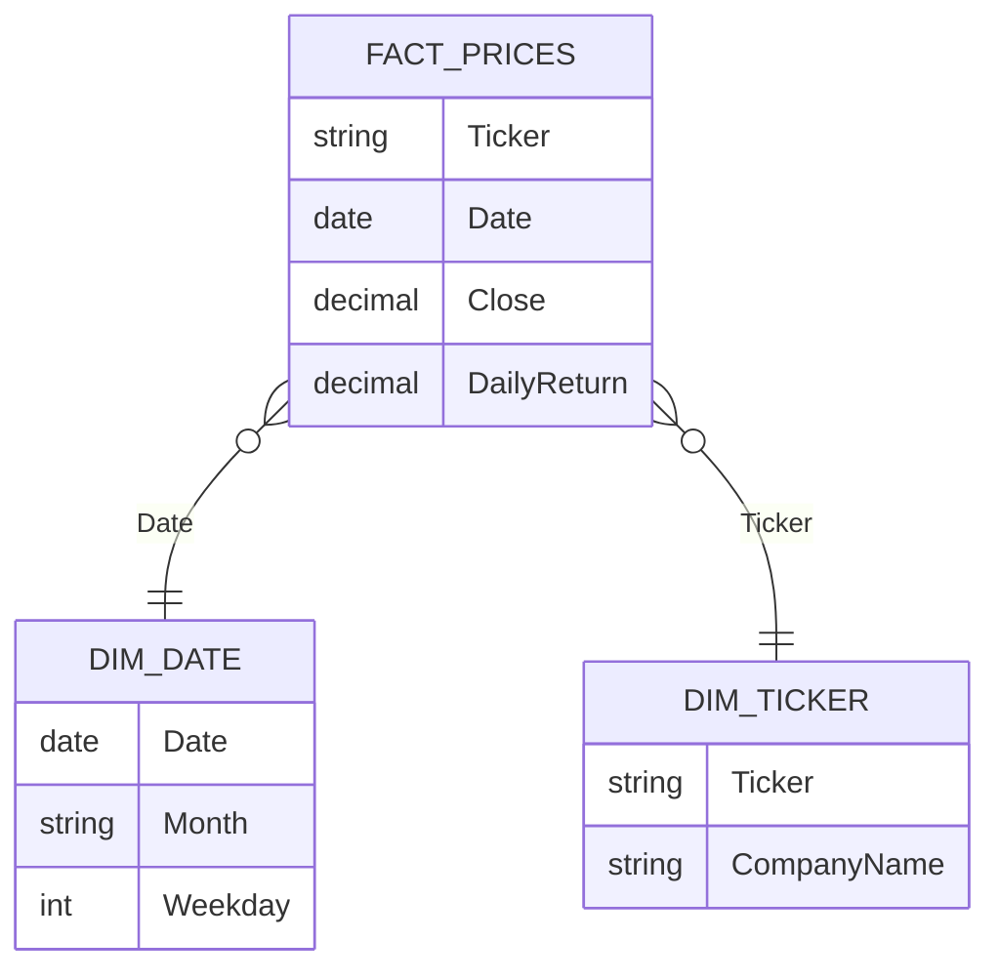

 # Microsoft Power BI para Business Intelligence e Data Science

## Dashboard Analítico do Mercado de Ações

- mercado de ações -> empresas vendem parte de sua propriedade para os investidores
    - lucro da empresa -> dividendos para os acionistas
    - valor da ação é volátil e depende de muitos fatores
- indicador de saúde financeira do país
- NASDAQ -> bolsa de negociação das empresas de tecnologia
    - totalmente eletrônica
- dados reais podem ser extraídos via download nos sites ou integração via API
- gráfico de linhas usados para evidenciar tendências temporais
- gráfico de área evidencia **soma / total ao longo tempo**
- dicas para séries temporais
    - *TimeIntelligence* - medidas rápidas para gerar códigos DAX

## Definindo Estatística

- coleta, análise, interpretação, apresentação e organização dos dados
    - tomada de decisão
    - previsões em situação de incerteza
- Descritiva -> organização, resumo e apresentação de dados
- Inferencial -> Técnicas e métodos para reutilizar generalizações e previsões
- Estatística **não** representa o mesmo conceito que *data science*
- Campo multidisciplinar
- Estatística + programação + área de negócios
- Data Science -> Resolver problemas complexos -> Dentro de data science

- **Estatística**
    - Física e Astronomia,
    - Economia,
    - Ciências Sociais,
    - Markting e Negócios, 
    - Engenharia e Qualidade, 
    - Biologia e Meio Ambiente,
    - Governo e Políticas Públicas, 
    - Educação, 
    - Esportes

- Estatística Descritiva -> Compreensão plena sobre os dados completados

    - **Tabelas e gráficos**
        - Frequências
        - Historiogramas
        - Gráficos de barras, colunas, setores, dispensão e linha
    - **Medidas de tendência central**
        - Média
        - Mediana
        - Moda
    - **Medidas de Dispensão**
        - Variância
        - Desvio Padrão
        - Amplitude
    - **Medidas Posição**
        - Quartis, percentuais

- Estatística Inferencial -> Estimar características da população, testar hipóteses e fazer previsões
    - **Estimação**
    - Pontual
    - Intervalar
    - **Testes de Hipóteses**
        - Comparar médias
        - Comparar proporções
    - **Análise de Regressão**
        - Modelar a relação entre uma variável dependente e uma ou mais variáveis independentes
        - Previsão de valores futuros
        - Variáveis que mais impactam
    - **Análise de Variância**
        - Comparar médias de dois ou mais grupos
    - **Modelos probabilísticos e análises de séries temporais**
        - Eventos aleatórios
        - Evolução de variáveis ao longo do tempo

- Power BI -> Business intelligence (estatística descritiva)

- Big Data Analytics -> Examinar, analisar e extrair informações valiosas de grandes conjuntos de dados
    - Volume, variedade, velocidade
- Técnicas avançadas de análise de dados
    - Machine Learning 
    - Mineração de dados
    - Processamento de linguagem natural e análise de texto
    - Decisões mais informadas, eficiência operacional, novas oportunidades de negócios, vantagem competitiva

- **Big Data Analytics** 
    - Análise preditiva
    - Análise de sentimentos,
    - Detecção de fraudes,
    - Análise de riscos,
    - Recomendação personalizada, 
    - Otimização da cadeia de suprimentos
- Propulação -> Amostra aleatória simples estratificada/conglomerados -> Representação -> Propulsão

- Técnicas de amostragem -> Escolher amostra representativa

### Amostragem probabilística

- Cada elemento da população tem uma chance conhecida e não nula de ser selecionada para uma atmosfera:
    - Aleatória simples(todos os elementos tem a mesma probabilidade)
    - Sistemática(seleção em intervalos fixos)
    - Estratificada(Subgrupos homogêneos sujeito de amostragem aleatória)
    - Conglomerados(Subgrupos homogêneos, seleção aleatória e todos os elementos do conglomerado são selecionados para amostra)

### Amostragem não probabilística
- Não baseadas em probabilidade, mas fáceis e rápidos, amostras menos representativas
    - Conveniência (facilidade de acesso e disponibilidade)
    - Julgamento (Conhecimento e critérios dos julgadores) 
    - Quotas (Seleção com base em características específicas dos elementos)

- Parâmetro -> População, desconhecido, fixos
- Estatística -> Amostra, estimadas, Visível aleatória

- *Dados Primários* -> Informações coletads diretamento pelo pesquisador para responder a uma pergunta da pesquisa
    - São Originais
    - Métodos diretos de coleta de informações
    - Relevância direta
    - Podem demorar ou serem caros de serem coletados

- *Dados Secundários* -> Informações já coletadas e disponíveis anteriormente
    - Reutilizados para responderem novas perguntas
    - Economia de recuros e tempo
    - Podem não serem relevantes ou atualizados
    - Limitações em termo de qualidade e confiabilidade
    - Múltiplas fontes

- *Observações* -> Unidades individuais de informação,  Instância única de objeto mensurado, Linhas

- *Variáveis* -> Colunas, características ou atributos, Propriedades/Qualidades

- **Variáveis:**
    - Qualitativas -> Nominas , Ordinais
    - Quantitativas -> Discretas , Continuas

- *Medidas de Dispensão* -> Consistência de Dados
- *Coeficiente de Variação* -> Comparar a dispensão de dois conjuntos de dados com amplitudes distintas
- *Percentis* -> Comparam a posição relativa com um valor dentro de diferentes conjuntos de dados

### Limpeza e Manipulação de Dados

- Sem dados limpos e organizados, todo trabalho de análise fica compremetido

```
Moda = 
    VAR TabelaFrequencia = 
        SUMMARIZE(
            tabela,
            tabela[coluna],
            "FrequEncia", COUNT(tabela[coluna])
        )
    VAR MaiorFrequencia = 
        MAXX(
            TabelaFrequencia,
            [Frequencia]
        )
    RETURN 
        CONCATENATEX(   
            FILTER(TabelaFrequencia, [Frequencia] =    
            MaiorFrequencia),
            Tabela[Coluna], ", "
        )

```
- Cálculo do coeficiente de variação

```
CV = DIVIDE(
    STDEV.P(tabela[coluna]),
    AVERAGE(tabela[coluna])
) * 100
```

- **Limpeza e Manipulação**

    - remoção de dados duplicados
    - renomeação e reorganização das colunas
    - tratamento de valores ausentes
    - erros digitação ou inconsistências
    - tipos de dados
    - detecção / tratamento outliers
    - transformação
    - normalização / padronização
    - discretização / binning
    - seleção de dados / filtragem
    - codificação de variáveis categóricas

- pode-se utilizar o gráfico de dispersão para identificar *outliers*
    - usar o posicionamento das linhas horizontais para processar os dados
- valores ausentes -> ausência de informação
    - nem sempre aparecem como valores nulos
- para identificar dados duplicados -> contagem de valores únicos
    - contagem x contagem (distinta) -> no caso de duplicatas, essa relação é diferente
- Power Query pode ajudar a identificar a qualidade de dados
    - filtros para encontrar dados nulos e outliers
    - agrupamento para linhas duplicadas
- tratamento de valores duplicados
    - Power Query -> substituir valores
- mostrar cartas de controle para identificar outliers
- para calcular valores acumulados:

```
Acumulado = CALCULATE(
    expressao,
    DATEYTD(calendario[datas])
)
```

- valores cumulativos passados

```
cum.past = CALCULATE(
    acumulado,
    DATEADD(
        calendario[dates],
        -1,
        MONTH
    )
)
```

## Example Use Case

### Scenario

An analyst follows one fictional stock, **NRX**, over 12 trading days in March 2024. The raw export has problems that must be fixed before any statistics are valid:

- a **duplicate row** for 6 March;
- prices stored as **text** with a comma decimal (`105,00`) for some rows;
- weekends missing from the date table, so a calendar-day "previous day" is wrong.

The example shows the cleaning steps, then the metrics: daily return, cumulative return, a 5-day moving average, volatility, price dispersion, and outliers with the IQR rule. The stock is fictional. Every number was computed by hand. The data lives only in this wiki page.

### Research context

- Annualized volatility is the daily standard deviation scaled by $\sqrt{252}$ trading days ([Investing.com: realized volatility](https://www.investing.com/academy/analysis/realized-volatility-definition), [Wikipedia mirror: volatility](https://kaweah.freedombox.rocks/kiwix/wikipedia_en_all_maxi_2023-10/Market_volatility)).
- The IQR rule flags values below $Q_1 - 1.5\,\text{IQR}$ or above $Q_3 + 1.5\,\text{IQR}$ ([TradingView: IQR outlier indicator](https://www.tradingview.com/script/gBuDumOX-Volume-Outlier-Signal-Detector-Based-on-IQR)).
- Daily returns need the previous close. Sources suggest `LASTNONBLANKVALUE` inside `CALCULATE`, or a column that looks up the previous trading day ([Fabric community: daily stock return](https://community.fabric.microsoft.com/t5/DAX-Commands-and-Tips/How-to-calculate-daily-stock-return-using-DAX-formula/m-p/1546460)).
- Moving averages and year-to-date measures use the standard time-intelligence functions ([The Bricks: moving average](https://www.thebricks.com/resources/guide-how-to-calculate-moving-average-in-power-bi), [Enterprise DNA: YTD monthly moving average](https://forum.enterprisedna.co/t/moving-averages-basic/8255)).
- The cumulative-return formula below is the standard definition; no source gave it explicitly.

### Metrics and equations

**Simple daily return:**

$$
r_t = \frac{P_t}{P_{t-1}} - 1
$$

**Cumulative return from the first close in the sample:**

$$
R_t = \frac{P_t}{P_0} - 1
$$

**Trailing 5-trading-day moving average:**

$$
\text{MA}_5(t) = \frac{1}{5} \sum_{i=0}^{4} P_{t-i}
$$

**Daily volatility (population) and annualized volatility:**

$$
\sigma_r = \sqrt{\frac{1}{n}\sum_{i=1}^{n}(r_i - \bar{r})^2}
\qquad
\sigma_{\text{ann}} = \sigma_r \sqrt{252}
$$

**Coefficient of variation of prices:**

$$
\text{CV}_P = \frac{\sigma_P}{\bar{P}} \times 100
$$

**IQR outlier bounds for returns:**

$$
\text{IQR} = Q_3 - Q_1
\qquad
\text{Lower} = Q_1 - 1.5\,\text{IQR}
\qquad
\text{Upper} = Q_3 + 1.5\,\text{IQR}
$$

> **Why trading days, not calendar days?** A 5-day window over calendar days can contain only three trading days when a weekend falls inside it. The moving average then averages a different number of prices. The measure below takes the last five trading rows instead.

### Data model

A price fact table at one row per ticker per trading day, a ticker dimension, and a contiguous date table covering every calendar day in March 2024.



| Table | Type | Grain | Notes |
|---|---|---|---|
| `Fact_Prices` | Fact | One ticker × one trading day | Clean close; `DailyReturn` is a calculated column |
| `Dim_Date` | Dimension | One calendar day | `CALENDAR` for March 2024, includes weekends (no price on those days) |
| `Dim_Ticker` | Dimension | One ticker | Fictional company name |

### Cleaning steps (Power Query)

The raw export before cleaning:

| Date | Ticker | Close (raw) |
|---|---|---|
| 2024-03-01 | NRX | 100.00 |
| 2024-03-04 | NRX | 102.00 |
| 2024-03-05 | NRX | 101.00 |
| 2024-03-06 | NRX | "105,00" (text) |
| 2024-03-06 | NRX | "105,00" (text, **duplicate**) |
| 2024-03-07 | NRX | 104.00 |
| 2024-03-08 | NRX | 108.00 |
| 2024-03-11 | NRX | 107.00 |
| 2024-03-12 | NRX | "110,00" (text) |
| 2024-03-13 | NRX | 109.00 |
| 2024-03-14 | NRX | 90.00 |
| 2024-03-15 | NRX | 99.00 |
| 2024-03-18 | NRX | 100.00 |

The cleaning steps, in order:

1. **Convert text to numbers.** Replace the comma with a point, then parse.
2. **Remove duplicates** on the key (date and ticker).
3. **Check the key.** `COUNT` should equal `DISTINCTCOUNT` after this step.

```m
let
    Source = Raw_Prices,
    // Step 1: "105,00" -> 105.00
    ConvertedClose = Table.TransformColumns(
        Source,
        {{"Close", each Number.FromText(Text.Replace(_, ",", "."), "en-US"), type number}}
    ),
    // Step 2: one row per ticker and date
    Distinct = Table.Distinct(ConvertedClose, {"Ticker", "Date"})
in
    Distinct
```

After cleaning: **12 rows**. Before cleaning: 13 rows, and `COUNT` gave 13 while `DISTINCTCOUNT` of dates gave 12.

### Sample data (clean)

| Date | Close | Daily Return | Cumulative Return | MA5 |
|---|---|---|---|---|
| 2024-03-01 | 100.00 | – | 0.00% | – |
| 2024-03-04 | 102.00 | +2.00% | +2.00% | – |
| 2024-03-05 | 101.00 | −0.98% | +1.00% | – |
| 2024-03-06 | 105.00 | +3.96% | +5.00% | – |
| 2024-03-07 | 104.00 | −0.95% | +4.00% | 102.40 |
| 2024-03-08 | 108.00 | +3.85% | +8.00% | 104.00 |
| 2024-03-11 | 107.00 | −0.93% | +7.00% | 105.00 |
| 2024-03-12 | 110.00 | +2.80% | +10.00% | 106.80 |
| 2024-03-13 | 109.00 | −0.91% | +9.00% | 107.60 |
| 2024-03-14 | 90.00 | −17.43% | −10.00% | 104.80 |
| 2024-03-15 | 99.00 | +10.00% | −1.00% | 103.00 |
| 2024-03-18 | 100.00 | +1.01% | 0.00% | 101.60 |

### Calculated columns and measures (DAX)

```dax
-- Fact_Prices: previous trading day's close, found by date rather than by calendar offset
Daily Return =
VAR CurrentDate = Fact_Prices[Date]
VAR PrevDate =
    CALCULATE(
        MAX(Fact_Prices[Date]),
        FILTER(ALL(Fact_Prices), Fact_Prices[Date] < CurrentDate)
    )
VAR PrevClose =
    CALCULATE(MAX(Fact_Prices[Close]), Fact_Prices[Date] = PrevDate)
RETURN
    IF(
        ISBLANK(PrevClose),
        BLANK(),
        DIVIDE(Fact_Prices[Close], PrevClose) - 1
    )
```

```dax
Close = MAX(Fact_Prices[Close])

-- Close on the first date in the sample
Start Close =
VAR FirstDate = MINX(ALL(Fact_Prices), Fact_Prices[Date])
RETURN
    CALCULATE(MAX(Fact_Prices[Close]), Fact_Prices[Date] = FirstDate)

Cumulative Return % = DIVIDE([Close] - [Start Close], [Start Close])

-- Trailing 5 trading days, taken as rows rather than calendar days
MA5 Close =
VAR LastDate = MAX(Fact_Prices[Date])
VAR Last5 =
    TOPN(
        5,
        FILTER(ALL(Fact_Prices), Fact_Prices[Date] <= LastDate),
        Fact_Prices[Date],
        DESC
    )
RETURN
    AVERAGEX(Last5, Fact_Prices[Close])

Daily Return % = AVERAGE(Fact_Prices[Daily Return])

Mean Return = AVERAGEX(FILTER(ALL(Fact_Prices), NOT ISBLANK(Fact_Prices[Daily Return])), Fact_Prices[Daily Return])

-- Population standard deviation, as in the lesson
Daily Volatility = STDEV.P(Fact_Prices[Daily Return])

Annualized Volatility = [Daily Volatility] * SQRT(252)

Price CV % = DIVIDE(STDEV.P(Fact_Prices[Close]), AVERAGE(Fact_Prices[Close])) * 100
```

```dax
-- Return quartiles, ignoring the blank first-day return
Return Q1 =
PERCENTILEX.INC(
    FILTER(ALL(Fact_Prices), NOT ISBLANK(Fact_Prices[Daily Return])),
    Fact_Prices[Daily Return],
    0.25
)

Return Q3 =
PERCENTILEX.INC(
    FILTER(ALL(Fact_Prices), NOT ISBLANK(Fact_Prices[Daily Return])),
    Fact_Prices[Daily Return],
    0.75
)

Return IQR = [Return Q3] - [Return Q1]
Lower Bound = [Return Q1] - 1.5 * [Return IQR]
Upper Bound = [Return Q3] + 1.5 * [Return IQR]

-- Days whose return falls outside the IQR fences
Outlier Days =
COUNTROWS(
    FILTER(
        ALL(Fact_Prices),
        NOT ISBLANK(Fact_Prices[Daily Return])
            && (Fact_Prices[Daily Return] < [Lower Bound]
                || Fact_Prices[Daily Return] > [Upper Bound])
    )
)
```

### Expected results

These values were calculated by hand from the clean sample. Each statistic is over the 11 daily returns (the first day has no return) unless stated otherwise.

| Measure | Value |
|---|---|
| Mean daily return | +0.22% |
| Daily volatility (population) | 6.40% |
| Annualized volatility ($\times\sqrt{252}$) | 101.55% |
| Daily volatility (sample, `STDEV.S`, for comparison) | 6.71% |
| Return Q1 / median / Q3 | −0.94% / +1.01% / +3.32% |
| Return IQR | 4.26% |
| Lower / upper fence | −7.34% / +9.72% |
| Outlier days | 2: 14 March (−17.43%) and 15 March (+10.00%) |
| Mean close | 102.92 |
| Price CV (population) | 5.16% |
| Close median / P25 / P75 | 103.00 / 100.00 / 107.25 |
| Highest / lowest close | 110.00 (12 March) / 90.00 (14 March) |
| Cumulative return at 18 March | 0.00% |

Working for the two fences: $Q_1 = -0.94\%$ and $Q_3 = 3.32\%$ gives IQR $= 4.26\%$, so the lower fence is $-0.94\% - 6.39\% = -7.34\%$ and the upper fence is $3.32\% + 6.39\% = 9.72\%$. The two outliers sit outside both bounds.

### Mapping to the lesson's material

- **Price trend:** line chart of `Close` and `MA5 Close` over the date axis, to smooth noise.
- **Cumulative performance:** area chart of `Cumulative Return %`, the lesson's "sum over time" view.
- **Return distribution and outliers:** scatter or column chart of `Daily Return %` with the fences as reference lines.
- **Dispersion:** cards for volatility and CV, with the lesson's note that CV compares dispersion across series with different scales.
- **Data quality:** a card with `COUNT` and `DISTINCTCOUNT` of dates, to show the duplicate is gone.

### Pitfalls shown in this example

- **Calendar-day offsets.** `DATEADD(Date, -1, DAY)` on Monday 4 March returns Sunday 3 March, which has no price. The daily return would be blank for every Monday. The `Daily Return` column looks up the previous trading date instead.
- **Duplicate rows.** Counting rows gives 13 for the raw data, but there are 12 trading days. Use `DISTINCTCOUNT` on the key to check.
- **Text prices.** `105,00` is text, so it cannot be summed or averaged until it is converted.
- **`STDEV.P` vs `STDEV.S`.** The population form gives 6.40%, the sample form 6.71%. With 11 returns the difference matters. Say which one the dashboard uses.
- **Outliers dominate volatility.** The 14 March drop and 15 March rebound drive most of the 101.55% annualized figure. Report volatility with and without outliers, or flag the event.
- **Sample size.** With 11 returns, quartiles and fences are unstable. This example is for checking formulas, not for judging the stock.
- **Calendar gaps in the trend line.** Weekends have no price, so a line chart over a continuous calendar axis draws straight lines across them. Use a trading-day axis or accept the gaps.