# Microsoft Power BI para Business Intelligence e Data Science

## Power Query MLanguage

- Linguagem programação do PowerQuery para realizar ETL

- Programação funcional baseada em fórmulas

- Manipulação, transformação e preparação de dados

- Sintaxe simples e concisa

- Permite a criação de funções personalizadas

- Engenharia de Atributos:

  - Criação, seleção e transformação de atributos
  - Melhorar desempenho, tornar dados mais informáticos e relevantes
    - Seleção
    - Transformação
    - Criação de novos atributos
    - Tratamento Valores Ausentes
    - Codificação de Variávreis categóricas
  - Etapa crucial -> Qualidade de Dados, Desempenho de Modelo

- Cada operação de transformação é convertida em intruções de linguagem M
  - Conhecimento permite a customização de transformação de dados
    - Alternativas (R, Python)

- Código na barra acima dos dados do PowerQuery -> Linguagem M
  - Exibição -> 'Editor Avançado'
  - Exibição => Qualidade da Coluna (Apresenta um resumo com valores válidos, valores com erro e valores ausentes)

- CUIDADO! Valores como "?" são considerados como válidos, se o tipo da coluna for texto mesmo se isso for para coluna numérica

  - Exibição => Distribuição de Colunas(Apresenta pequenos gráficos de distribuição, outliers e valores distintos e exclusivos)
  - Sintaxe Básica

  ```{M}
  LET
    --- Bloco de comando
  IN
    -- nome da tabela
  ```

- 'Ler Arquivo: '

```
Fonte = Csv.Document(
    File.Contents(<caminho_do_arquivo>),
    {Delimiter=",", Columns=no-columns, Encoding=65001 (tipo da codificação), QueryStyle=tipo_de_aspas}
)
```
- Cada comando é separado por vírgula

- 'Promover Cabeçalhos: '

```
"Novo_nome" = Table.PromoteHeaders(
    Fonte (ou a tabela anterior),
    {PromoteAllScalars=true}
)
```
- Valida valores escalares para realizar a promoção

- 'Codificar Tipos'

```
Table.TransformColumnTypes(
    tabela_a_ser_modificada,
    {{"nome_coluna", type tipo-coluna}, ...}
)
```

- comentário ---> //

- 'Substituir Valor'

```
Table.ReplaceValue(tabela_a_ser_modificada, valor_original, valor_novo, Replacer.ReplaceText, {nome-coluna})
```

- 'Remover Colunas'

```
Table.RemoveColumns(tabela_a_ser_modificada, {"nome_coluna"})
```


- 'Adicionar Coluna Calculada'

```
Table.AddColumn(tabela_transformada, nome_nova_coluna, each operação_com_outras_colunas)
```

- 'Dividir Colunas'

```
Table.SplitColumn(tabela_transformada,
    coluna_separada,
    Splitter.SplitTextByPositions({0.4}, false),
    {nome_novo-1, nome-novo-2})
```

- 'Renomear Colunas'

```
Table.RenameColumn(
    tabela_transformada,
    {
        {coluna-1, coluna-n},
        {novo-nome-1, novo-nome-2}
    }
)
```

- 'Criando Coluna Condicional'

```
Table.AddColumn(
    tabela_transformada,
    nome_nova_coluna
        each if ... than valor_if
        else if ... than valor_else_if
        else valor_else
)
```

- 'Transformação com Funções Definidas'

```
Table.TransformColumns(
    tabela_transformada,
    {
        {nome-nova-coluna, função_definida (ex. Number.Log10), tipo de saída (type Number)}
    }
)
```

- Tarefas independentes são intercambiáceis entre si.
  - Tomar cuidado com nomes nas tabelas nas diferentes transformações

- Linguagem M:
  - focada em ETL
  - Limpeza e Transformação
  - Combinação e agregação

- Expressão DAX:
  - Foca em Análise
  - Medidas Dinâmicas que reagem a filtros
  - Colunas e Tabelas Calculadas
  - Inteligência Temporal
  - Funções e Filtros de Contexto

## Example Use Case

### Scenario

A small retailer exports its customer list from a CRM as a CSV file. Before the Power BI model can use it, the export needs an ETL pass in Power Query M. The file has these problems:

- `?` in the numeric `Age` column, which M reads as valid text;
- names with stray spaces, a double space, and mixed case;
- revenue written as `$1,250.50` text, with a dollar sign and thousands separators;
- signup dates as text in `MM/dd/yyyy`;
- a customer (C001) listed twice.

The example builds one clean `Dim_Customer` table and shows the row count and data quality after each step. Every number was computed by hand. The file is inline in this wiki page only.

### Research context

- `Table.TransformColumns` takes pairs of column names and transform functions. `MissingField.Ignore` avoids errors when a listed column is absent, and column names are case-sensitive ([Microsoft Learn: Table.TransformColumns](https://learn.microsoft.com/powerquery-m/table-transformcolumns), [TrumpExcel](https://trumpexcel.com/power-query/functions/table-transformcolumns/)).
- `Text.Trim` removes only the outer spaces and returns text. Interior spaces stay, so names with double spaces need an extra step ([Spreadsheet Planet: Text.Trim](https://spreadsheetplanet.com/?p=28521)).
- Converting a column to text makes its values unusable in calculations until they are converted back ([TrumpExcel](https://trumpexcel.com/?p=44863)).
- A custom function can apply one cleaning rule to many columns ([Fabric community](https://community.fabric.microsoft.com/t5/Power-Query/Reading-to-a-new-table-only-the-text-values/m-p/2696235)).

### Metrics and equations

Data quality is measured with two ratios, for each column $c$ and key $k$:

$$
\text{Completeness}(c) = \frac{|\{r : x_{r,c} \neq \varnothing\}|}{|R|} \times 100
$$

$$
\text{Uniqueness}(k) = \frac{|\text{DISTINCT}(k)|}{|R|} \times 100
$$

where $R$ is the set of rows.

**Revenue per customer and segment thresholds:**

$$
\text{Avg Revenue} = \frac{1}{|C|}\sum_{c \in C} \text{Revenue}_c
$$

Segments use business rules: VIP for revenue of 5,000 or more, Core for 1,000 to under 5,000, and Low for under 1,000.

> **Why replace `?` before converting the type?** M cannot convert `?` to a number. If `Age` is converted to an integer first, the step fails. Replacing `?` with null first turns it into a missing value that the integer type accepts.

### Pipeline (Mermaid)

```mermaid
flowchart LR
    A["Raw CSV<br/>11 rows"] --> B["Promote headers"]
    B --> C["Replace '?' with null<br/>Age: 3 nulls"]
    C --> D["Normalize names<br/>5 rows changed"]
    D --> E["Clean currency<br/>custom function"]
    E --> F["Parse dates<br/>MM/dd/yyyy"]
    F --> G["Set types<br/>Age as Int64"]
    G --> H["Remove duplicates<br/>by CustomerID<br/>10 rows"]
    H --> I["Split name<br/>FirstName, LastName"]
    I --> J["Add Segment<br/>VIP, Core, Low"]
    J --> K[("Dim_Customer")]
```



The output, `Dim_Customer`, is a single table loaded into the model. It has no relationships of its own; the orders table would be a separate query.

### Sample data

**Raw CSV** (`crm_export.csv`, as delivered)

```csv
CustomerID,Name,Email,Age,Revenue,SignupDate,Region
C001, ana SILVA ,ana@mail.com,34,"$1,250.50",03/15/2024,North
C002,Bruno  Lima,bruno@mail.com,?,"$480.00",01/22/2024,South
C003,CARLA souza,carla@mail.com,41,"$3,900.00",11/05/2023,North
C004,Diego Rocha,diego@mail.com,?,"$75.25",02/10/2024,East
C005, eva Nunes ,eva@mail.com,29,"$2,310.00",12/30/2023,East
C001,Ana Silva,ana@mail.com,34,"$1,250.50",03/15/2024,North
C006,Felipe Dias,felipe@mail.com,57,"$0.00",04/01/2024,South
C007,Gabi Ramos,gabi@mail.com,?,"$1,015.75",05/18/2024,North
C008,hugo PAIVA,hugo@mail.com,38,"$12,500.00",06/02/2023,West
C009,Iara Costa,iara@mail.com,25,"$640.10",07/07/2024,West
C010,Joao Melo,joao@mail.com,62,"$2,050.00",08/20/2023,South
```

Row 6 is a second record for C001, with the name written differently.

### Power Query M

```m
let
    Source = Csv.Document(
        File.Contents("crm_export.csv"),
        [Delimiter = ",", Encoding = 65001, QuoteStyle = QuoteStyle.Csv]
    ),
    Promoted = Table.PromoteHeaders(Source, [PromoteAllScalars = true]),

    // 1. "?" becomes null in Age, before any numeric conversion
    NoQuestionMarks = Table.ReplaceValue(Promoted, "?", null, Replacer.ReplaceValue, {"Age"}),

    // 2. Custom functions: one rule each, reused across columns
    NormalizeName = (t as nullable text) as nullable text =>
        if t = null then null
        else Text.Combine(
            List.Select(Text.Split(Text.Proper(Text.Trim(t)), " "), each _ <> ""),
            " "
        ),
    CleanCurrency = (t as text) as number =>
        Number.FromText(Text.Replace(Text.Replace(t, "$", ""), ",", ""), "en-US"),

    // 3. Apply the transforms column by column
    Cleaned = Table.TransformColumns(
        NoQuestionMarks,
        {
            {"Name", NormalizeName, type nullable text},
            {"Email", each Text.Lower(Text.Trim(_)), type text},
            {"Revenue", CleanCurrency, type number},
            {"SignupDate", each Date.FromText(_, [Format = "MM/dd/yyyy", Culture = "en-US"]), type date}
        }
    ),

    // 4. Types after the replacement, so "?" is already null
    Typed = Table.TransformColumnTypes(Cleaned, {{"Age", Int64.Type}}),

    // 5. One row per customer
    Distinct = Table.Distinct(Typed, {"CustomerID"}),

    // 6. Split the name and add the segment
    Split = Table.SplitColumn(
        Distinct,
        "Name",
        Splitter.SplitTextByDelimiter(" ", QuoteStyle.None),
        {"FirstName", "LastName"}
    ),
    WithSegment = Table.AddColumn(
        Split,
        "Segment",
        each if [Revenue] >= 5000 then "VIP"
             else if [Revenue] >= 1000 then "Core"
             else "Low",
        type text
    )
in
    WithSegment
```

### Expected results

These values were calculated by hand from the sample.

**Row count and changes after each step:**

| Step | Rows | What changed |
|---|---|---|
| Read CSV | 11 | Raw export as delivered |
| Replace `?` with null | 11 | 3 nulls in `Age` (C002, C004, C007) |
| Normalize names | 11 | 5 names changed (C001, C002, C003, C005, C008) |
| Clean currency | 11 | Raw revenue total 25,472.10 |
| Parse dates | 11 | Text dates become date values |
| Set types | 11 | `Age` becomes Int64 |
| Remove duplicates by CustomerID | **10** | Second C001 row dropped; revenue 24,221.60 |
| Split name | 10 | `FirstName` and `LastName` columns |
| Add segment | 10 | VIP 1, Core 5, Low 4 |

**Clean `Dim_Customer` output:**

| CustomerID | FirstName | LastName | Email | Age | Revenue | SignupDate | Region | Segment |
|---|---|---|---|---|---|---|---|---|
| C001 | Ana | Silva | ana@mail.com | 34 | 1,250.50 | 2024-03-15 | North | Core |
| C002 | Bruno | Lima | bruno@mail.com | *(null)* | 480.00 | 2024-01-22 | South | Low |
| C003 | Carla | Souza | carla@mail.com | 41 | 3,900.00 | 2023-11-05 | North | Core |
| C004 | Diego | Rocha | diego@mail.com | *(null)* | 75.25 | 2024-02-10 | East | Low |
| C005 | Eva | Nunes | eva@mail.com | 29 | 2,310.00 | 2023-12-30 | East | Core |
| C006 | Felipe | Dias | felipe@mail.com | 57 | 0.00 | 2024-04-01 | South | Low |
| C007 | Gabi | Ramos | gabi@mail.com | *(null)* | 1,015.75 | 2024-05-18 | North | Core |
| C008 | Hugo | Paiva | hugo@mail.com | 38 | 12,500.00 | 2023-06-02 | West | VIP |
| C009 | Iara | Costa | iara@mail.com | 25 | 640.10 | 2024-07-07 | West | Low |
| C010 | Joao | Melo | joao@mail.com | 62 | 2,050.00 | 2023-08-20 | South | Core |

**Summary figures:**

- Revenue total after cleaning: **24,221.60** (average 2,422.16 per customer). Revenue by segment: VIP 12,500.00; Core 10,526.25; Low 1,195.35.
- Signups by year: 2023 has 4 customers, 2024 has 6.
- Average age of the 7 customers with an age: 286 / 7 = **40.86**.
- Data quality, raw (11 rows) vs clean (10 rows):

| Metric | Raw | Clean |
|---|---|---|
| Uniqueness of CustomerID | 10 / 11 = 90.91% | 10 / 10 = 100.00% |
| Completeness of Age | 8 / 11 = 72.73% | 7 / 10 = 70.00% |
| Email contains `@` | 100.00% | 100.00% |

### Mapping to the lesson's material

- **Column quality** (the lesson's view): after the replacement step, the `Age` column shows 3 empty values, not 3 valid text values. The view counts valid, error, and empty values, which is where the `?` problem appears.
- **Column distribution:** shows the revenue spread and the three segments.
- **Advanced Editor:** the M code above is the one-to-one record of the steps in the Applied Steps pane.

### Pitfalls shown in this example

- **`?` is valid text.** Left as text, it passes the quality check for a text column. Once the column is numeric, it fails the type change, so the replacement must come first.
- **Type before cleaning.** Converting `Revenue` to a number before removing `$` and commas makes every value fail. Clean the text, then convert.
- **Interior spaces.** `Text.Trim` leaves `Bruno  Lima` with a double space. The `NormalizeName` function splits and rejoins to remove it.
- **Duplicates by full row.** The two C001 rows differ in name case and spacing, so a whole-row `Table.Distinct` would keep both. Deduplicate on the key.
- **Locale-dependent dates.** `03/15/2024` parses only as month-first. In a day-first locale, it fails, and `05/06/2024` would silently become a different date. Set the culture explicitly.
- **Case-sensitive names.** `Name` and `name` are different columns in the step references.
- **Segment thresholds.** The rules are business decisions. A revenue of exactly 1,000 falls in Core, so the boundary should be agreed with the business.
