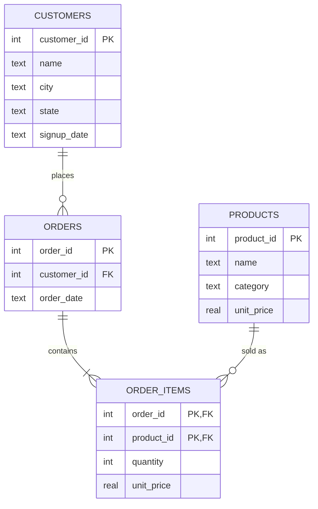
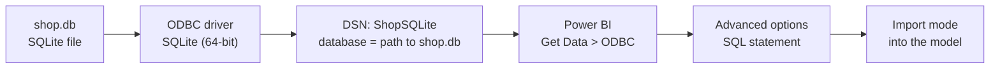

# Microsoft Power BI para Business Intelligence e Data Science

## Power BI e Banco de Dados

- Sistema de gerenciadores de Banco de Dados
    - Softwares responsáceis por administrar bancos de dados
        - Criar, Manter, Proteger, e otimizar o acesso aos dados
        - Facilitar insenção, atualização, exclusão e consulta

- SGBD:
    - Relacionais
        - Dados Armazenados em tabelas relacionadas entre si
            - SQL
    - Não-Relacionais
        - Escaláveis e Distribuídos
        - Documentos, columnames, Grados chave valor
    - Controles de transações e recuperação
    - Consistência dos Dados, integridade referencial, Segurança e Acesso

- SGBD pode gerenciar cem ou mais bancos de dados
- Ateção aos 'conectores necessários' para conectar o banco de dados no Power BI
- 'ODBC' -> Conexão universa para bancos de dados
    - Open DataBase Conectivity
    - API padrão conexão com SGBDs
    - Sem modificação do código fonte para SGBD(abstração para ínterface comum)
    - Drivers tradução para comandos específicos de cada SGBD
- Fonte de Dados OBDC
    - Adicionar Driver
    - Instalar Driver (Devart-OBDC DRiver for SQLite)
        - O Driver não é gratuito

- DSN => Data Source Names
    - Depois de instalar o driver, preencher as informações necessárias
    - "Test Connection"

- No Power BI, conectar normalmente pelas fontes de dados, ele lê os DNS registrados no Windows 
    - Pode-se usar uma consultar SQL se apenas partes dos dados forem desejadas
    - Vai pedir usuário e senha ao banco de dados 

- Conforme necessidade, configurar as credenciais do banco de dados, e do windows
    - Sempre que houver mais de uma tarefa, é bom checar o modelo de dados construído e as respectivas relações entre as tabelas

- Exemplo de Consulta no momento da extração
```
SELECT id_cliente, cidade, estado, pais
FROM tb_dsa_clientes
```
- Cria uma tabela com apenas dados retornados na consulta

## SQL Analytics

- SQL -> Linguagem para manipulaçao de dados armazenados em SGBD relacionais
- Criar, modificar, consultar e controlar o acesso aos dados
- DIVISÕES PRINCIPAIS: 
    - DDL (Data Definition Language)
        - `CREATE` - Criar
        - ``ALTER`` - Alterar
        - ``DROP`` - Excluir
    - DML (Data Manipulation Language)
        - ``SELECT`` - Selecionar
        - ``INSERT`` - Inserir
        - ``UPDATE`` - Atualizar
        - ``DELETE`` - Deletar
    - DCL (Data Control Language)
        - ``GRANT`` - Dar Privilégios
        - ``REVOKE`` - Retirar privilégios
    - TCL (Transaction Control Language)
        - ``COMMIT`` - confirmar
        - ``ROLLBACK`` - Voltar
        - ``SAVEPOINT`` - Ponto de Salvamento
- Linguagem Declarativa (usuários concentrados na lógica).

- SQL Analytics -> Análise de Dados com SQL
    - Análise(descritiva, diagnóstica, preditiva, prescritiva)
    - Agregação e Transformação
    - Integração com ferramentas BI
    - Visualização
    - Otimização de Desempenho
    - Escalabilidade
- IDe para manipulação SQLite -> Sqlite Studio, DBeaver
    - Adicionar Bancos de Dados
    - Selecionar o arquivo do banco de dados

- ``SELECT * FROM tabela`` -> Selecione todas as colunas da tabela "tabela" (todas as linhas também)
- Explicitando os nomes das colunas, aplicamos filtros em 'Nível da Coluna'
    - Não importa a ordem deal das colunas

- ``LIMIT`` -> Limita o tamanho da amostra a ser retornada após a consulta
- ``DISTINCT`` -> Para retornar apenas valores únicos presentes numa coluna
- ``WHERE`` -> Aplica um filtro em 'Nível de Linha'

- Operadores Relacionais (ou de comparação).
    - `=` -> Igualdade 
    - ``>=`` -> Maioridade ou Igualdade
    - `>` -> Maioridade 
    - ``<=`` -> Minoridade ou Igualdade
    - ``<`` -> Minoridade

- Operadores Lógicos (Para construir expressões lógicas complexas)
    - ``AND`` -> Operador "E" (intersecção)
    - ``NOT`` -> Operador Negativo
    - ``OR``  -> Operador "OU" (união)
    - ``BEETWEEN`` -> Retorna consultas dentro de um intervalo numérico ou de datas
    - ``LIKE`` -> Procurar registros que possuam uma determinada sequência de caracteres
    - ``IN`` -> Filtros baseados em linhas porém quando as colunas possam estar dentro de uma lista possível de valores
    ``ORDER BY`` -> Claúsula para realização de ordenação
        - ``ASC`` -> Ordem Crescente
        - ``DESC`` -> Ordem Decrescente

- Funções Estatísticas(Agreção)
    - ``MIN`` -> Valor Mínimo
    - ``MAX`` -> Valor Máximo
    - ``AVG`` -> Valor Médio
    - ``SUM`` -> Somatório
    - ``COUNT`` -> Contagem de linhas" 
- Podem ser usadas juntamente com a declaração ``GROUP BY``

- ``GROUP BY`` => Instrução de Agregação que permite o cálculo das fuções estatísticas para cada categoria
    - A coluna que não está dentro das funções de agregação geralmente são as categorias de agrupamento

- ``AS`` -> Clásula de modificação dos nomes das colunas de saída(alias)
- ``ROUND`` -> Arredondar os valores numéricos
- ``JOIN`` -> Cláusula que permite realizar a junção entre duas tabelas(PK = FK)
    - Pode ser feito com a cláusula ``WHERE``
    - Podem ser feitos múltiplos ``JOINS``, combinando-se diversas expressões lógicas
        - lembras de colocar novas colunas no ``GROUP BY`` e também na ``SELECT``
- ``INSERT INTO tabela (lista-colunas) VALUES (lista-valores)``
    - Para inserir novos dados na tabela

- ``UPDATE Table SET Coluna_a_ser_modificada = novo valor WHERE linhas_filtradas``
    - Para atualizar dados armazenados no banco
    - se não colocar a cláusula `WHERE`, todos os registros da tabela serão atualizados

- ``DELETE FROM tabela WHERE linhas = condicao_eliminacao`` 
    - Eliminar Linhas da Tabela
    - sem a especificação do `WHERE` todas as linhas da tabela serão deletadas

## Example Use Case

### Scenario

A small online shop keeps its orders in a SQLite file, `shop.db`, with four tables. The business team wants these metrics in Power BI:

- revenue and order count per customer, including customers who never bought;
- average order value (AOV);
- monthly revenue;
- the top products by revenue;
- revenue by state.

The example builds the database with SQL, writes the queries in SQLite syntax, and connects Power BI through ODBC in Import mode. The sample is small, so every result below was produced by running the script in SQLite, not guessed. The data lives only in this wiki page.

### Research context

- Power BI has no built-in SQLite connector. Connecting uses an ODBC driver and a DSN, and through ODBC SQLite supports Import mode only ([The Bricks: Power BI and SQLite](https://www.thebricks.com/resources/guide-can-power-bi-connect-to-sqlite-database), [Fabric community: connecting SQLite](https://community.fabric.microsoft.com/t5/Power-Query/connecting-a-SQLite-database/m-p/224205)).
- A free SQLite ODBC driver exists (ch-werner.de). Devart's driver is paid after a 30-day trial, so the lesson's suggestion needs that caveat.
- Revenue per customer joins customers to orders and sums. If order items are also joined, totals must be computed per order first, or they are double counted. AOV should average order totals, not item lines ([oneuptime: joins with aggregates](https://oneuptime.com/blog/post/2026-03-31-mysql-join-aggregate-functions/view), [Infinisynapse: GROUP BY](https://infinisynapse.com/en/tool/group-by-sql)).
- A `LEFT JOIN` keeps customers with no orders, which a count can show as zero ([oneuptime](https://oneuptime.com/blog/post/2026-03-31-mysql-join-aggregate-functions/view)).
- Many guides use MySQL or Postgres syntax. The queries below use SQLite functions (`strftime`) and were run in SQLite.

### Metrics and equations

**Order total** (sum of quantity times unit price over the order's items):

$$
T_o = \sum_{i \in o} q_i \cdot p_i
$$

**Revenue per customer** (sum of order totals; customers with no orders get zero):

$$
\text{Revenue}_c = \sum_{o \in \text{orders}(c)} T_o
$$

**Average order value** (average over orders, not over item lines):

$$
\text{AOV} = \frac{1}{|O|} \sum_{o \in O} T_o
$$

> **Why compute order totals before averaging?** Joining orders to items gives one row per item. Averaging those rows measures the average item line, which is a different number. The sample below shows the gap: 54.50 per line against 85.64 per order.

### Data model

Four tables in one SQLite file. Customers place orders; each order contains items; each item refers to a product.



`order_items` has a composite primary key `(order_id, product_id)`, so an order cannot list the same product twice. `unit_price` is stored on the item, because the price at the time of sale can differ from the current catalogue price.

### Connection path (Mermaid)



The DSN is created once in the Windows ODBC Data Source Administrator, with the driver installed. Power BI Desktop is 64-bit, so the driver must be 64-bit too. Check the exact connection-string keyword in your driver's documentation.

### Sample database (SQL script)

Run this in DBeaver or SQLiteStudio to create `shop.db`. It uses only DDL (`CREATE`) and DML (`INSERT`) from the lesson.

```sql
CREATE TABLE customers (
    customer_id INTEGER PRIMARY KEY,
    name        TEXT NOT NULL,
    city        TEXT,
    state       TEXT,
    signup_date TEXT
);
CREATE TABLE products (
    product_id INTEGER PRIMARY KEY,
    name       TEXT NOT NULL,
    category   TEXT,
    unit_price REAL
);
CREATE TABLE orders (
    order_id    INTEGER PRIMARY KEY,
    customer_id INTEGER REFERENCES customers(customer_id),
    order_date  TEXT
);
CREATE TABLE order_items (
    order_id   INTEGER REFERENCES orders(order_id),
    product_id INTEGER REFERENCES products(product_id),
    quantity   INTEGER,
    unit_price REAL,
    PRIMARY KEY (order_id, product_id)
);

INSERT INTO customers VALUES
 (1,'Ana Silva','Austin','TX','2023-11-02'),
 (2,'Bruno Lima','Denver','CO','2024-01-10'),
 (3,'Carla Souza','Austin','TX','2024-02-14'),
 (4,'Diego Rocha','Boston','MA','2024-03-03'),
 (5,'Eva Nunes','Denver','CO','2024-03-20');

INSERT INTO products VALUES
 (1,'Desk Lamp','Home',25.00),
 (2,'Notebook','Office',4.50),
 (3,'Office Chair','Furniture',180.00),
 (4,'Desk Organizer','Office',12.00);

INSERT INTO orders VALUES
 (101,1,'2024-01-05'),
 (102,2,'2024-01-18'),
 (103,1,'2024-02-11'),
 (104,3,'2024-02-25'),
 (105,2,'2024-03-02'),
 (106,4,'2024-03-09'),
 (107,3,'2024-03-22');

INSERT INTO order_items VALUES
 (101,1,2,25.00),
 (101,2,3,4.50),
 (102,3,1,180.00),
 (103,4,2,12.00),
 (103,1,1,25.00),
 (104,2,10,4.50),
 (105,1,1,25.00),
 (105,4,1,12.00),
 (106,3,1,180.00),
 (106,2,2,4.50),
 (107,4,3,12.00);
```

Eva Nunes (customer 5) has no orders on purpose, to test the `LEFT JOIN`.

### Queries

**Revenue and orders per customer.** Order totals are computed in a subquery first, so each order counts once.

```sql
SELECT c.name, c.city,
       COUNT(o.order_id) AS orders,
       ROUND(COALESCE(SUM(t.order_total), 0), 2) AS revenue
FROM customers c
LEFT JOIN orders o ON o.customer_id = c.customer_id
LEFT JOIN (
    SELECT order_id, SUM(quantity * unit_price) AS order_total
    FROM order_items
    GROUP BY order_id
) t ON t.order_id = o.order_id
GROUP BY c.customer_id, c.name, c.city
ORDER BY revenue DESC, c.name;
```

**Average order value.**

```sql
SELECT COUNT(*) AS orders,
       ROUND(AVG(order_total), 2) AS aov,
       ROUND(SUM(order_total), 2) AS total
FROM (
    SELECT order_id, SUM(quantity * unit_price) AS order_total
    FROM order_items
    GROUP BY order_id
);
```

**Monthly revenue.** `strftime('%Y-%m', ...)` is SQLite's way to get a year-month key from the text date.

```sql
SELECT strftime('%Y-%m', o.order_date) AS month,
       COUNT(o.order_id) AS orders,
       ROUND(SUM(t.order_total), 2) AS revenue
FROM orders o
JOIN (
    SELECT order_id, SUM(quantity * unit_price) AS order_total
    FROM order_items
    GROUP BY order_id
) t ON t.order_id = o.order_id
GROUP BY month
ORDER BY month;
```

**Top three products by revenue.**

```sql
SELECT p.name, p.category,
       SUM(i.quantity) AS units,
       ROUND(SUM(i.quantity * i.unit_price), 2) AS revenue
FROM order_items i
JOIN products p ON p.product_id = i.product_id
GROUP BY p.product_id, p.name, p.category
ORDER BY revenue DESC
LIMIT 3;
```

**Revenue by state.** Customers without orders drop out here because of the inner joins, which is the intended result for this metric.

```sql
SELECT c.state,
       COUNT(DISTINCT c.customer_id) AS customers,
       ROUND(SUM(i.quantity * i.unit_price), 2) AS revenue
FROM customers c
JOIN orders o       ON o.customer_id = c.customer_id
JOIN order_items i  ON i.order_id = o.order_id
GROUP BY c.state
ORDER BY revenue DESC;
```

**Customers with no orders.**

```sql
SELECT c.name
FROM customers c
LEFT JOIN orders o ON o.customer_id = c.customer_id
WHERE o.order_id IS NULL;
```

### Expected results

These are the outputs of running the script and the queries in SQLite. Hand checks are shown for the key figures.

**Revenue per customer**

| Name | City | Orders | Revenue |
|---|---|---|---|
| Bruno Lima | Denver | 2 | 217.00 |
| Diego Rocha | Boston | 1 | 189.00 |
| Ana Silva | Austin | 2 | 112.50 |
| Carla Souza | Austin | 2 | 81.00 |
| Eva Nunes | Denver | 0 | 0.00 |

Hand check: Ana's orders are 101 ($50 + $13.50 = $63.50) and 103 ($24 + $25 = $49.00), total $112.50.

**Average order value**

| Orders | AOV | Total |
|---|---|---|
| 7 | **85.64** | 599.50 |

Hand check: $599.50 / 7 = 85.64.

**Monthly revenue**

| Month | Orders | Revenue |
|---|---|---|
| 2024-01 | 2 | 243.50 |
| 2024-02 | 2 | 94.00 |
| 2024-03 | 3 | 262.00 |

**Top three products**

| Name | Category | Units | Revenue |
|---|---|---|---|
| Office Chair | Furniture | 2 | 360.00 |
| Desk Lamp | Home | 4 | 100.00 |
| Desk Organizer | Office | 6 | 72.00 |

Notebook is fourth with 15 units but only 67.50 in revenue, so it is not in the top three.

**Revenue by state**

| State | Customers | Revenue |
|---|---|---|
| CO | 1 | 217.00 |
| TX | 2 | 193.50 |
| MA | 1 | 189.00 |

**Customers with no orders:** Eva Nunes.

### Pitfalls shown in this example

- **Averaging item lines.** Joining orders to items and averaging gives 54.50, the average item line. The AOV is 85.64. The gap is the reason for the order-total subquery.
- **`WHERE` on the right table of a `LEFT JOIN`.** `WHERE o.order_date >= '2024-02-01'` removes Eva, who has no order, and also drops Bruno's January order. The query returns 5 rows, and the two January orders are excluded.
- **Filter in `ON`.** Moving the date condition into the `ON` clause keeps every customer. Eva appears with a `NULL` order. Bruno's and Ana's January orders no longer match and disappear from the result, but both customers still appear through their February and March orders. The query returns 6 rows, against 5 for the `WHERE` version.
- **Text dates.** SQLite stores dates as text, so `'2024-02-01'` comparisons work only in `YYYY-MM-DD` format. Another format sorts and filters wrongly.
- **Driver bitness.** A 32-bit driver does not appear in a 64-bit Power BI Desktop. Install the driver that matches Power BI.
- **Destructive statements.** `UPDATE` or `DELETE` without `WHERE` changes every row. The examples above use only `SELECT`, `INSERT` and `CREATE`.
- **Import only.** Through ODBC, SQLite connects in Import mode. A dashboard that needs to refresh from the file must be refreshed through the gateway, and only on a machine where the ODBC connection works.