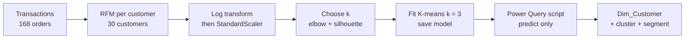
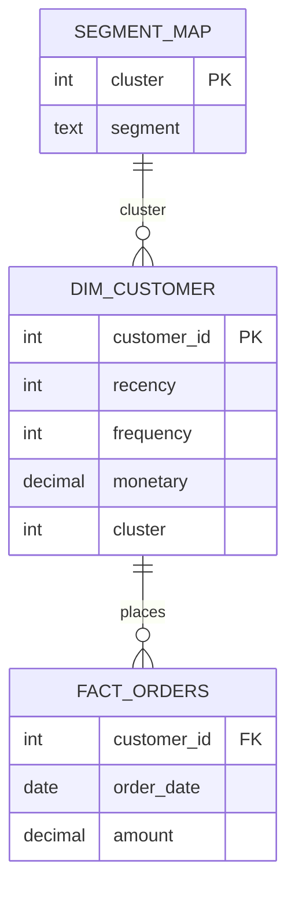

# Microsoft Power BI para Business Intelligence e Data Science

## O que é Machine Learning?

- subárea da Inteligência Artificial
- Computadores realizam tarefas sem terem sidos explicitamentes programados para tal
- Identificar padrões, fazer previsões, tomar decisões

- Machine Learning
    - Supervisionado
        - dedicado a determinar a função $f$, conhecidos $X$ e $y$, de tal forma que $f(x) = y$ - ou seja, preciso de dados rotulados
    - Não supervisionado
        - Dado um conjunto de características $X$, devemos encontrar grupos e estruturas internas por meio de similaridades
    - Aprendizado por Reforço
        - um agente toma decisões e aprende por meio do prejuízo ou recompensa resultante das ações

## O que é Segmentação de Clientes?

- Dividir a base de clientes em grupos com relação a características comuns
- Entender as necessidades e desejos de cada grupo
    - Personalização de estratégias e experiência
- Critérios de Segmentação:
    - Demográficos
    - Geográficos
    - Psicográficos
    - Comportamentais
- Identificar nichos não explorados de mercado
- Melhorar experiência e satisfação dos clientes
- Otimizar alocação de recursos

- Power BI vai ser utilizado para realizar a visualização de dados construidos sobre a linguagem de programação 
    - Toda a modelagem, análise exploratória e preparação de IA sendo feita em Python e Jupiter Notebook
    - Segmentação de Clientes -> Problema de dustenização ou agrupamento
        - KMeans
    - Possivel abrir um relatório Power BI dentro do Jupiter Notebook
        - Precisa de uma licença Power BI Service
        ```
        !pip install -q (instalação silenciosa) powerbiclient
        from powerbiclient import QuickVisualize, get_dataset_config, Report
        from powerbiclient.authentication import DevideCodeLoginAuthentication

        # Define autenticação
        device_auth = DevideCodeLoginAuthentication()

        # Cria Relatório
        relatorio_PBI = QuickVisualize(get_dateset_config(Df), auth = device_auth)
        relatorio_PBI
        ```

## Example Use Case

### Scenario

A subscription store wants to group its customers by behaviour, so that marketing can treat each group differently. Each customer is described by three RFM features:

- **Recency:** days since the last order, measured against a fixed reference date;
- **Frequency:** number of orders;
- **Monetary:** total spend.

The clustering is done in Python with K-means. Power BI displays the segments and shows what each one is worth. The example is fully reproducible: the orders are generated with a fixed random seed, so the script produces the same customers, clusters and numbers every time. The data is synthetic and lives only in this wiki page.

### Research context

- K-means is sensitive to scale, so the features are standardized first. RFM values are usually skewed, with a few very large customers, so a log transform comes before scaling ([DEV Community: RFM and K-means](https://dev.to/maikpaixao/segmentacao-de-clientes-usando-rfm-e-k-means-15ph), [KDnuggets: customer segmentation in Python](https://www.kdnuggets.com/customer-segmentation-in-python-a-practical-approach)).
- Choose $k$ with the elbow method and the silhouette score. A higher silhouette means better-separated clusters. The two methods can disagree, so the choice also has to be interpretable ([Topbots](https://www.topbots.com/?p=10712), [Sustainability Methods: K-means in Python](https://sustainabilitymethods.org/index.php/K-Means_Algorithm_in_Python)).
- Power BI can run Python in Power Query. A script that retrains K-means on every refresh can return different labels when the data changes. Saving the fitted model and only calling `predict` keeps labels stable ([Towards Data Science: clustering in Power BI with PyCaret](https://towardsdatascience.com/how-to-implement-clustering-in-power-bi-using-pycaret-4b5e34b1405b), [KDnuggets: machine learning in Power BI](https://www.kdnuggets.com/2020/05/machine-learning-power-bi-pycaret.html)).

### Metrics and equations

**Recency, frequency and monetary value for customer $c$, with reference date $R$:**

$$
\text{Recency}_c = R - \max_{o \in c} \text{OrderDate}_o
\qquad
\text{Frequency}_c = |\{o \in c\}|
\qquad
\text{Monetary}_c = \sum_{o \in c} \text{Amount}_o
$$

**Log transform and standardization (applied to each feature $x$):**

$$
x' = \ln(1 + x)
\qquad
z = \frac{x' - \mu}{\sigma}
$$

**K-means objective (the inertia that the elbow method plots against $k$):**

$$
J = \sum_{j=1}^{k} \sum_{z \in C_j} \lVert z - \mu_j \rVert^2
$$

**Silhouette of point $i$, where $a(i)$ is the mean distance to its own cluster and $b(i)$ the smallest mean distance to another cluster:**

$$
s(i) = \frac{b(i) - a(i)}{\max\big(a(i),\, b(i)\big)}
$$

The average of $s(i)$ over all customers is the silhouette score. Higher is better.

> **Why log before scaling?** A customer with a monetary value of 2,700 would otherwise sit far from the rest and pull a cluster centre toward itself. The log compresses that tail, so the scaled features describe the bulk of the customers.

### Pipeline (Mermaid)



### Data model

Orders are the fact table. Each customer has one row in `Dim_Customer`, carrying the RFM values and the cluster. `Segment_Map` translates the cluster number into a business name.



`Segment_Map` is a small table typed in by hand, with one row per cluster. Its names come from reading the cluster profiles, not from the algorithm.

### Python: generate, segment and save

This is the script used to produce the sample. It runs with pandas, numpy, scikit-learn and joblib.

```python
"""Customer segmentation: generate orders, compute RFM, scale, choose k, fit K-means, save model."""
from datetime import date, timedelta
import joblib
import numpy as np
import pandas as pd
from sklearn.cluster import KMeans
from sklearn.metrics import silhouette_score
from sklearn.preprocessing import StandardScaler

REF = date(2024, 6, 30)
rng = np.random.default_rng(42)

# 1. Synthetic transactions: four behaviour profiles (count, orders range, amount mean/sd, recency range in days)
PROFILES = [
    (8, (8, 13), 220, 40, (0, 40)),      # loyal
    (12, (3, 7), 90, 25, (20, 90)),      # regular
    (6, (1, 3), 60, 15, (100, 300)),     # occasional
    (4, (2, 4), 120, 30, (250, 365)),    # lapsed
]
orders, cid = [], 0
for count, (n_lo, n_hi), mu, sd, (r_lo, r_hi) in PROFILES:
    for _ in range(count):
        cid += 1
        n = int(rng.integers(n_lo, n_hi + 1))
        recency = int(rng.integers(r_lo, r_hi + 1))
        dates = [REF - timedelta(days=recency)]
        if n > 1:
            dates += [REF - timedelta(days=int(d)) for d in rng.integers(recency + 1, 365, size=n - 1)]
        for d in sorted(dates):
            orders.append((cid, d.isoformat(), round(max(5.0, rng.normal(mu, sd)), 2)))
orders = pd.DataFrame(orders, columns=["customer_id", "order_date", "amount"])
orders.to_csv("orders.csv", index=False)

# 2. RFM per customer, relative to the reference date
od = orders.assign(order_date=pd.to_datetime(orders["order_date"]))
rfm = od.groupby("customer_id").agg(
    last_order=("order_date", "max"),
    frequency=("amount", "count"),
    monetary=("amount", "sum"),
).reset_index()
rfm["recency"] = (pd.Timestamp(REF) - rfm["last_order"]).dt.days
rfm["monetary"] = rfm["monetary"].round(2)
rfm = rfm[["customer_id", "recency", "frequency", "monetary"]]
rfm.to_csv("rfm.csv", index=False)

# 3. Log transform (skew), then standardize (scale)
features = ["recency", "frequency", "monetary"]
scaler = StandardScaler().fit(np.log1p(rfm[features].to_numpy(float)))
X = scaler.transform(np.log1p(rfm[features].to_numpy(float)))

# 4. Choose k: inertia (elbow) and silhouette for k = 2..8
print("k  inertia  silhouette")
for k in range(2, 9):
    km = KMeans(n_clusters=k, random_state=42, n_init=10).fit(X)
    print(k, round(km.inertia_, 2), round(silhouette_score(X, km.labels_), 4))

# 5. Fit the chosen model (k = 3) and save it, so the Power BI script only predicts
K = 3
model = KMeans(n_clusters=K, random_state=42, n_init=10).fit(X)
joblib.dump({"kmeans": model, "scaler": scaler}, "segment_model.joblib")
rfm["cluster"] = model.labels_
rfm.to_csv("rfm_labelled.csv", index=False)
print(rfm.groupby("cluster")[features].mean().round(2).to_string())
print(rfm.groupby("cluster").size().to_string())
```

**Output of the scan (k = 2 to 8):**

| k | Inertia | Silhouette |
|---|---|---|
| 2 | 36.10 | **0.5308** |
| 3 | 16.39 | 0.5290 |
| 4 | 12.39 | 0.4679 |
| 5 | 8.51 | 0.4996 |
| 6 | 6.37 | 0.5235 |
| 7 | 5.28 | 0.3912 |
| 8 | 4.34 | 0.3912 |

**Choice of k = 3.** The highest silhouette is at k = 2 (0.5308), but k = 3 is within 0.002 of it (0.5290), and it is where the inertia curve bends sharply (36.10 to 16.39, then a much smaller drop to 12.39). Three groups are also easy to name for the business. k = 2 would merge the active and lapsed customers into one group. The rule is: among values close to the best silhouette, choose the one that the elbow and the business can explain.

### Power Query: predict with the saved model

In Power BI, **Transform data → Run Python script** runs this on the `dataset` table (the RFM table). It loads the saved model and only predicts, so the labels do not change on refresh.

```python
import joblib
import numpy as np

bundle = joblib.load(r"C:\models\segment_model.joblib")
X = bundle["scaler"].transform(
    np.log1p(dataset[["recency", "frequency", "monetary"]].to_numpy(float))
)
dataset["cluster"] = bundle["kmeans"].predict(X)
```

The Python environment that Power BI uses must have the same scikit-learn version that trained the model, because the saved object depends on it. Check the version before relying on the saved labels.

### Sample data (RFM and cluster, 30 customers)

The 168 orders behind these values are generated by the script. Recency is in days, measured to 30 June 2024.

| customer_id | recency | frequency | monetary | cluster | segment |
|---|---|---|---|---|---|
| 1 | 31 | 8 | 1,734.51 | 2 | Champions |
| 2 | 16 | 8 | 1,745.74 | 2 | Champions |
| 3 | 7 | 12 | 2,645.76 | 2 | Champions |
| 4 | 34 | 13 | 2,771.94 | 2 | Champions |
| 5 | 3 | 12 | 2,553.76 | 2 | Champions |
| 6 | 0 | 10 | 2,021.48 | 2 | Champions |
| 7 | 15 | 11 | 2,235.57 | 2 | Champions |
| 8 | 20 | 12 | 2,661.09 | 2 | Champions |
| 9 | 21 | 4 | 511.56 | 1 | Active |
| 10 | 51 | 5 | 407.17 | 1 | Active |
| 11 | 45 | 5 | 412.94 | 1 | Active |
| 12 | 86 | 3 | 203.77 | 0 | Lapsed |
| 13 | 30 | 3 | 247.86 | 1 | Active |
| 14 | 34 | 4 | 349.84 | 1 | Active |
| 15 | 23 | 5 | 501.97 | 1 | Active |
| 16 | 42 | 5 | 500.74 | 1 | Active |
| 17 | 37 | 7 | 612.99 | 1 | Active |
| 18 | 30 | 5 | 394.81 | 1 | Active |
| 19 | 61 | 6 | 525.84 | 1 | Active |
| 20 | 42 | 6 | 525.73 | 1 | Active |
| 21 | 294 | 1 | 88.15 | 0 | Lapsed |
| 22 | 287 | 1 | 55.69 | 0 | Lapsed |
| 23 | 193 | 2 | 142.82 | 0 | Lapsed |
| 24 | 157 | 3 | 129.41 | 0 | Lapsed |
| 25 | 287 | 3 | 157.50 | 0 | Lapsed |
| 26 | 293 | 2 | 129.93 | 0 | Lapsed |
| 27 | 277 | 2 | 382.26 | 0 | Lapsed |
| 28 | 352 | 4 | 505.14 | 0 | Lapsed |
| 29 | 356 | 4 | 419.60 | 0 | Lapsed |
| 30 | 272 | 2 | 237.49 | 0 | Lapsed |

**Segment map** (cluster → name, from the profiles):

| cluster | segment | Meaning |
|---|---|---|
| 2 | Champions | Recent, frequent, high spend |
| 1 | Active | Moderately recent, mid frequency, mid spend |
| 0 | Lapsed | Long since the last order, low frequency and spend |

### Measures (DAX)

```dax
Customers = COUNTROWS(Dim_Customer)

Revenue = SUM(Fact_Orders[amount])

Avg Recency = AVERAGE(Dim_Customer[recency])

Avg Frequency = AVERAGE(Dim_Customer[frequency])

Avg Monetary = AVERAGE(Dim_Customer[monetary])

-- Share of total revenue: the ALL removes the segment filter from the denominator
Revenue Share % =
DIVIDE(
    [Revenue],
    CALCULATE([Revenue], ALL(Dim_Customer))
) * 100
```

Revenue reaches `Fact_Orders` through `Dim_Customer`, so a segment slicer on `Segment_Map[segment]` filters both the customers and their orders.

### Expected results

These values come from running the pipeline. They are not hand calculations.

| Segment | Customers | Avg recency (days) | Avg frequency | Avg monetary | Revenue | Share % |
|---|---|---|---|---|---|---|
| Champions | 8 | 15.75 | 10.75 | 2,296.23 | 18,369.85 | 71.16% |
| Active | 11 | 37.82 | 5.00 | 453.77 | 4,991.45 | 19.34% |
| Lapsed | 11 | 259.45 | 2.45 | 222.89 | 2,451.76 | 9.50% |
| **Total** | **30** | | | | **25,813.06** | **100.00%** |

Totals check: 168 orders in `orders.csv`, and the monetary total of 25,813.06 equals the sum of all order amounts.

### Mapping to the lesson's material

- **Segment overview:** a card with `Customers` and a bar chart of `Revenue Share %` by segment.
- **Profiles:** a table of `Avg Recency`, `Avg Frequency` and `Avg Monetary` by segment, the lesson's "profile" view.
- **Segment comparison:** a scatter plot of frequency against recency, coloured by segment, with the lesson's note that scatter plots help identify outliers.
- **Segment-level drill-down:** a slicer on `Segment_Map[segment]`, with the customer list as a table.

### Pitfalls shown in this example

- **Scaling.** Without standardization, monetary (in the thousands) dominates recency (in days) and the clusters follow spend alone.
- **Choosing k.** The silhouette peaks at k = 2 (0.5308), but k = 3 is almost as good and more useful. k = 4 splits the lapsed group in two and drops the silhouette to 0.4679. The generator used four profiles, so the data does not fully support four distinct groups. The disagreement is worth reporting.
- **Silhouette direction.** A higher silhouette is better. Some tutorials state the opposite, so check the direction before reading the score.
- **Arbitrary labels.** Cluster `0` is not "lapsed" by definition. The names live in `Segment_Map`, which depends on the saved model. Retraining with a different seed can change the numbering, so the map must be rebuilt.
- **Retraining on refresh.** Calling `fit` in the Power Query script can change the labels when data changes. Use the saved model and `predict` instead.
- **Reference date.** Recency depends on 30 June 2024. Moving the date changes the segments, so the snapshot should say which date it uses.
- **Customers near a boundary.** Customer 12 is labelled Lapsed with a recency of 86 days, which is shorter than every other Lapsed customer's recency. Before acting on the label, compare its distance to the Lapsed and Active centres; a small change in the data could move it.
- **Python version.** The saved model needs the same scikit-learn version in Power BI as in the training environment.