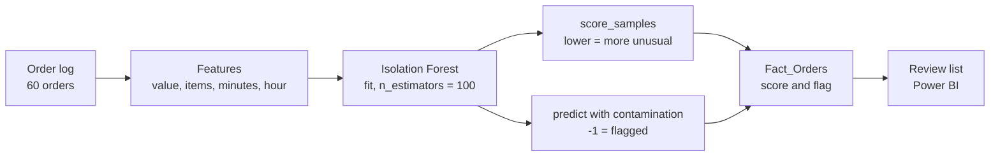
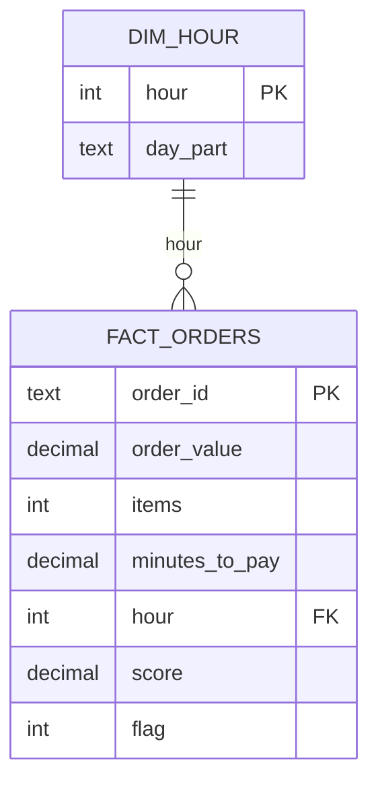

# Microsoft Power BI para Business Intelligence e Data Science

## Detecção de Anomalias

- Identificar padrões incomuns
- Observações diferentes em magnitude, frequência ou comportamento
- Erros, falhas, fraudes ou atividades maliciosas
    - Métodos Estatísticos
        - Testes de Hipóteses
        - Distribuição de Probabilidade
        - Medidas de Dispersão
    - Aprendizado Supervisionado
        - Modelo treinado com dados rotulados como normais e anômalos
    - Aprendizado Não-Supervisionado
        - Anomalias são pontos de dados que não se encaixam bem nos padrões e agrupamentos determinados
        - Distância significativa dos outros pontos
    - Aprendizado Semi-Supervisionado
        - Combina elementos do aprendizado supervisionado e não-supervisionado
        - Treinamento em conjuntos parcialmente rotulados
    - Métodos baseados em densidade
        - Anomalias são pontos em áreas de baixa densidade de pontos
    - Métodos baseados em vizinhança
        - Comparam a distância ou similidariedade ente pontos de dados e seus vizinhos
        - Dados muitos disitintos dos vizinhos são anomalias

- Aplicação de Detecção de Anomalias
    - Finanças
        - Fraudes em transacões
        - Monitoramento e Identificação de Manipulação de Mercado
    - Cibersegurança
        - Padrões Incomuns de Tráfego
        - Monitoramento de logs
    - Manuntenção Preditiva
        - Falhas iminentes desempenho degradado
        - anomalias em sinais de sensores
    - Monitoramento Ambiental
        - Eventos metereológicos extremos
        - Qualidade do ar e água para identificar poluição ou contaminação
    - Marketing e Venda
        - Padrões de Comportamento do Consumidor
        - Segmentos Incomuns
        - Identificação de Atividades Fraudulentas
    - Redes Sociais e Análise de Texto
        - Spam, Abuso ou Discurso de Ódio
        - Notícias falsas ou informações enganosas
- Algoritmo usado para detecção de anomalias multivariáveis
    - *Isolation Forest*
    - Se eu preciso de poucas divisões para isolar um ponto eles podem ser outliers multivariados
    - O *Isolation Forest* retorna um score de anomalia que pontua a probabilidade daquele ponto ser uma anomalia
- Na linguagem R, pode ser útil usar o operador de concatenação
    - `% > %`
- A definição de anomalias depende de uma decisão de projeto (valor de corte)

## Example Use Case

### Scenario

An online shop reviews its orders for suspicious activity. Each order has four features:

- **order value**, in dollars;
- **items**, the number of units;
- **minutes to pay**, from the cart to the payment;
- **hour**, the hour the order was placed.

The shop wants a short list of orders to review. The example uses 60 synthetic orders. Four of them are injected as known anomalies: large or very fast orders, placed in the early hours. One injected order (O060) looks ordinary, so the model misses it. That is a deliberate lesson about what a detector can and cannot find. The data is generated with a fixed seed and lives only in this wiki page.

### Research context

- Isolation Forest isolates points with random splits. Points that isolate in few splits are anomalies. It needs no labels ([scikit-learn: IsolationForest](https://scikit-learn.org/stable/modules/generated/sklearn.ensemble.IsolationForest.html)).
- `contamination` sets the expected share of outliers and so fixes the decision threshold. It is not a measure of the true anomaly rate ([scikit-learn docs](https://scikit-learn.org/1.5/modules/generated/sklearn.ensemble.IsolationForest.html), [Kanaries: Isolation Forest](https://ml.kanaries.net/docs/guides/isolation-forest)).
- scikit-learn's `predict` returns −1 for outliers, and `score_samples` is higher for normal points. This is the reverse of the convention in the original paper, so labels must be normalized before comparing results ([scikit-learn docs](https://scikit-learn.org/1.5/modules/generated/sklearn.ensemble.IsolationForest.html)).
- Fraud walkthroughs choose the threshold from the cost of missed fraud against the cost of false alarms, and check it against labelled cases ([Towards Data Science: real-time fraud detection](https://towardsdatascience.com/real-time-fraud-detection-with-machine-learning-485fa502087e)).

### Metrics and equations

**Isolation Forest anomaly score (Liu et al., 2008), where $E[h(x)]$ is the average path length of $x$ over the trees and $c(n)$ the average path length for $n$ samples:**

$$
s(x, n) = 2^{-\,E[h(x)] / c(n)}
\qquad
c(n) = 2H(n-1) - \frac{2(n-1)}{n}
$$

$H(i)$ is the harmonic number. A score near 1 means an anomaly; near 0.5 or below means normal.

**Z-score baseline, from lesson 05:**

$$
z = \frac{x - \mu}{\sigma}
\qquad
\text{flag if } |z| > 3
$$

**IQR fences, from lesson 05:**

$$
\text{Lower} = Q_1 - 1.5\,\text{IQR}
\qquad
\text{Upper} = Q_3 + 1.5\,\text{IQR}
$$

**Precision, recall and F1 against the labelled anomalies:**

$$
\text{Precision} = \frac{TP}{TP + FP}
\qquad
\text{Recall} = \frac{TP}{TP + FN}
\qquad
F_1 = \frac{2 \cdot \text{Precision} \cdot \text{Recall}}{\text{Precision} + \text{Recall}}
$$

> **Why is the score not the decision?** The score ranks orders from most to least unusual. The decision is a threshold on the score, and `contamination` chooses that threshold. Two users with the same scores can reach different flags if they use different contamination values.

### Pipeline (Mermaid)



### Data model

One fact table of orders, with the score and flag computed by Python. `Dim_Hour` gives the hourly view.



`flag` is `1` for flagged orders and `0` otherwise. It is stored as a number, so DAX can sum it.

### Python: generate, detect and score

```python
import numpy as np, pandas as pd
from sklearn.ensemble import IsolationForest
from sklearn.metrics import precision_score, recall_score, f1_score

rng = np.random.default_rng(42)
n_normal = 56
normal = pd.DataFrame({
    "order_id": [f"O{i:03d}" for i in range(1, n_normal + 1)],
    "order_value": np.round(np.clip(rng.normal(80, 20, n_normal), 5, None), 2),
    "items": rng.integers(1, 6, n_normal),
    "minutes_to_pay": np.round(np.clip(rng.normal(6, 2, n_normal), 0.5, None), 1),
    "hour": rng.integers(9, 22, n_normal),
    "is_injected": False,
})
injected = pd.DataFrame({
    "order_id": ["O057", "O058", "O059", "O060"],
    "order_value": [1500.0, 960.0, 1200.0, 45.0],
    "items": [40, 22, 35, 1],
    "minutes_to_pay": [0.2, 0.3, 0.4, 0.5],
    "hour": [3, 4, 3, 13],
    "is_injected": True,
})
df = pd.concat([normal, injected], ignore_index=True)
df.to_csv("orders_anomaly.csv", index=False)

feats = ["order_value", "items", "minutes_to_pay", "hour"]
X = df[feats].to_numpy(float)
y = df["is_injected"].astype(int).to_numpy()

# Sweep contamination (evaluated on the labels, for illustration only)
print("contamination  flagged  precision  recall  f1")
for c in [0.03, 0.05, 0.07, 0.10]:
    iso = IsolationForest(n_estimators=100, contamination=c, random_state=42).fit(X)
    pred = (iso.predict(X) == -1).astype(int)
    print(c, pred.sum(), round(precision_score(y, pred, zero_division=0), 3),
          round(recall_score(y, pred), 3), round(f1_score(y, pred), 3))

# Model used in the section: contamination 0.05
iso = IsolationForest(n_estimators=100, contamination=0.05, random_state=42).fit(X)
df["score"] = iso.score_samples(X)           # sklearn: higher = more normal
df["flag"] = (iso.predict(X) == -1).astype(int)
df.to_csv("orders_scored.csv", index=False)

# Baseline 1: z-score > 3 on any feature (lesson 05)
z = (df[feats] - df[feats].mean()) / df[feats].std(ddof=0)
zflag = (z.abs() > 3).any(axis=1).astype(int).to_numpy()
print("z>3 flagged", zflag.sum(), "precision", round(precision_score(y, zflag, zero_division=0), 3),
      "recall", round(recall_score(y, zflag), 3))

# Baseline 2: IQR fences on any feature (lesson 05)
out = np.zeros(len(df), dtype=bool)
for f in feats:
    q1, q3 = df[f].quantile(0.25), df[f].quantile(0.75)
    iqr = q3 - q1
    out |= ((df[f] < q1 - 1.5 * iqr) | (df[f] > q3 + 1.5 * iqr)).to_numpy()
print("IQR flagged", out.sum(), "precision",
      round(precision_score(y, out.astype(int), zero_division=0), 3),
      "recall", round(recall_score(y, out.astype(int)), 3))
```

Two notes on the script:

- The sweep uses the labels, so it shows the trade-off but is not an honest test. Choosing `contamination` on the same labels you report on overstates the result. Section "Pitfalls" returns to this.
- `score_samples` and `predict` come from the same fitted model, so their flags agree.

### Expected results

**Contamination sweep.** Labels are known for this sample, so precision and recall can be computed.

| contamination | Flagged | Precision | Recall | F1 |
|---|---|---|---|---|
| 0.03 | 2 | 1.000 | 0.500 | 0.667 |
| **0.05** | **3** | **1.000** | **0.750** | **0.857** |
| 0.07 | 5 | 0.800 | 1.000 | 0.889 |
| 0.10 | 6 | 0.667 | 1.000 | 0.800 |

The section's model uses **0.05**. It flags only orders with perfect precision, so the review list stays short. The F1 score is highest at 0.07 (0.889), which catches every injected order at the cost of one false alarm. Which to use is a business decision: a shorter list costs less review time, a longer one misses fewer frauds.

**Baselines (same data)**

| Method | Flagged | Precision | Recall |
|---|---|---|---|
| Isolation Forest, contamination 0.05 | 3 | 1.000 | 0.750 |
| z-score > 3 on any feature | 3 | 1.000 | 0.750 |
| IQR fences on any feature | 4 | 0.750 | 0.750 |

The univariate methods reach the same recall here. The difference is that the Isolation Forest looks at the four features together, so an order can be unusual in combination even when no single value is extreme. This sample does not test that case, so the comparison is not conclusive.

**Flagged orders (contamination 0.05)**

| order_id | order_value | items | minutes_to_pay | hour | score | injected |
|---|---|---|---|---|---|---|
| O057 | 1,500.00 | 40 | 0.2 | 3 | −0.7663 | yes |
| O058 | 960.00 | 22 | 0.3 | 4 | −0.7314 | yes |
| O059 | 1,200.00 | 35 | 0.4 | 3 | −0.7248 | yes |

The next lowest score is O056 at −0.5962, so the three flagged orders are well separated from the rest. O060 (order value 45.00, one item, 0.5 minutes, hour 13) scores −0.5822 and is not flagged. It is a real injected anomaly that the model misses, because a single cheap order placed at lunchtime does not look unusual across these four features.

### Measures (DAX)

```dax
Total Orders = COUNTROWS(Fact_Orders)

Flagged Orders = CALCULATE([Total Orders], Fact_Orders[flag] = 1)

Anomaly Rate % = DIVIDE([Flagged Orders], [Total Orders]) * 100

Total Order Value = SUM(Fact_Orders[order_value])

Flagged Value = CALCULATE([Total Order Value], Fact_Orders[flag] = 1)

Flagged Value Share % = DIVIDE([Flagged Value], [Total Order Value]) * 100

Avg Score (Flagged) = CALCULATE(AVERAGE(Fact_Orders[score]), Fact_Orders[flag] = 1)

-- Stricter cut-off, using FILTER on the score column
Highly Suspicious =
COUNTROWS(
    FILTER(Fact_Orders, Fact_Orders[score] < -0.70)
)
```

Score thresholds belong in a parameter table, not hard-coded in DAX, so the review list can change without rewriting the measure.

### Expected results

These values come from the sample above.

| Measure | Value |
|---|---|
| Total orders | 60 |
| Flagged orders | 3 |
| Anomaly rate | 5.00% |
| Total order value | 8,236.89 |
| Flagged value | 3,660.00 |
| Flagged value share | 44.43% |
| Average score, flagged | −0.7408 |
| Average score, not flagged | −0.4544 |
| Highly suspicious (score below −0.70) | 3 |

The flagged orders hold 44.43% of all order value from 5% of the orders, because the three injected orders are large. A review list sorted by value would find them as well, which is the point of the univariate baselines. The score adds value when the anomaly is only unusual in combination.

### Mapping to the lesson's material

- **Anomaly list:** a table of flagged orders sorted by `score`, with a card for `Anomaly Rate %`.
- **Where anomalies happen:** a column chart of flagged orders by `hour`, for the early-hours pattern.
- **Value at risk:** a card for `Flagged Value Share %`, the share of revenue under review.
- **Control chart:** the lesson's suggestion. A line chart of `score` by order, with a horizontal line at the threshold, shows which orders cross it.

### Pitfalls shown in this example

- **Contamination is not the anomaly rate.** The injected share is 4 of 60 (6.67%), but the best-F1 setting is 0.07 and the model uses 0.05. The threshold is a choice.
- **Tuning on the labels.** Picking contamination by F1 on the same labelled orders gives a result that will not repeat on new data. Tune on held-out data, or set the threshold from review capacity.
- **Label and score conventions.** `predict` returns −1 for outliers, and `score_samples` is higher for normal points. Mixing up the two gives a flipped result.
- **Missed anomalies.** O060 is an injected anomaly that is not flagged. A detector reports what it finds, not what exists.
- **Flagging is not fraud.** The list is a review queue. A flag means "look at this", not "this is fraud".
- **Scaling.** Isolation Forest splits each feature separately, so it does not need standardization. The z-score and IQR baselines are also unaffected by rescaling a single feature, but each one judges features one at a time, so they cannot see an unusual combination.
- **Small samples.** With 60 orders, one order changes precision by 0.2 or more. Treat these numbers as a check of the method, not an estimate of performance. 
