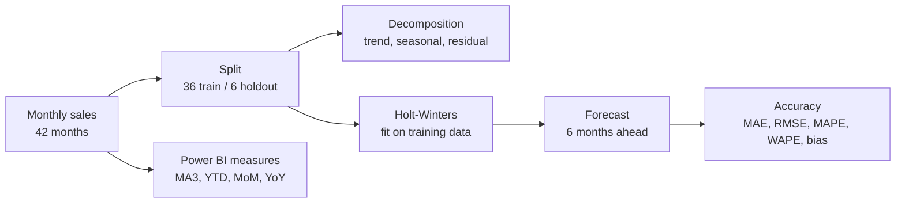
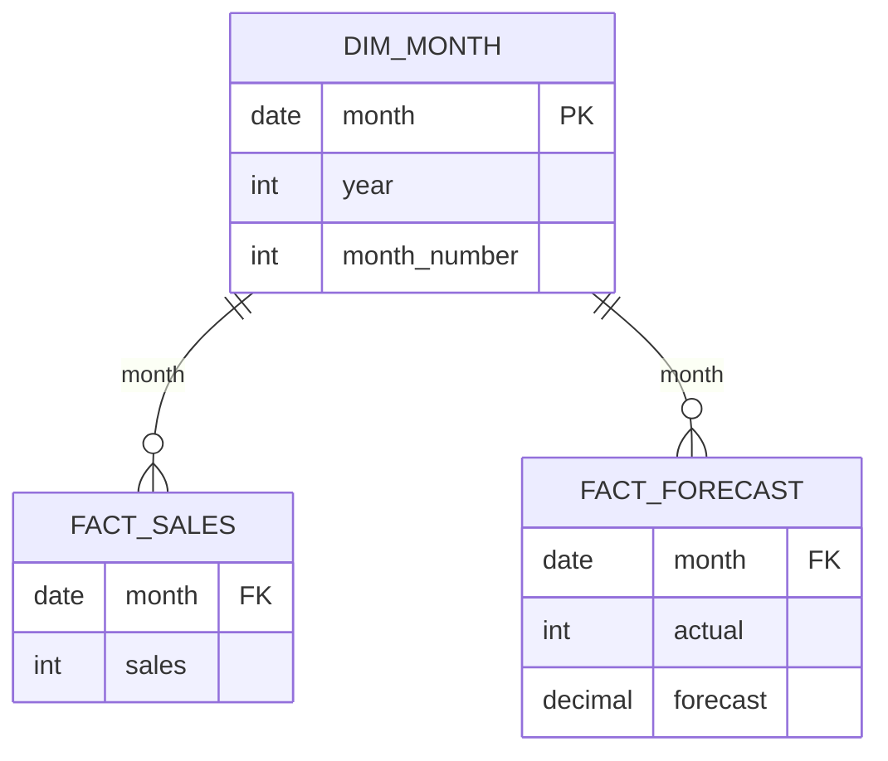

# Microsoft Power BI para Business Intelligence e Data Science

## Análise de Séries temporais

- Conjuntos de pontos coletados ao longo de períodos sequenciais do tempo
    - Prever dados do futuro com base em dados históricos
    - Coletados em intervalos regulares
    - Tendênia, Sazonalidade e Ciclos
- Técnicas para Análise de Séries Temporais
    - **Análise de Tendências:** aumento constantes ou queda constante
    - **Médias Móveis e Suavização Expondencial:** remoção de ruídos
    - **Decomposição:** tendência, sazonalidade e resíduos
    - **Modelos Autoregressivos(AR):** o valor presente é uma função linear dos valores passados
    - **Modelos Média Móvel(MA):** valor presente é uma combinação linear dos eixos de precisão dos momentos passados
    - **Modelos ARIMA(Auto Regressive Integrated Movings Average):** Combina modelos AR, MA, com um termo de diferenciação para garantir série espacionária
    - **Modelos de Aprendizado de Maquina, Modelos de Aprendizado Profundo:** RUUs, LSTMs, Transformadores

- Engenharia de Produção
    - Projeto, melhoria e instalação de sistemas interligados de pessoas, materiais, informações, equipamentos e energia
    - Eficiência, eficácia, produtividade, qualidade e sustentabilidade
    - Análise de processos, design, de sistemas, simulação, análise de custos e qualide, pesquisa operacional, logística, cadeia de suprimentos, economia, gestão de projeos, gestão dos recursos humanos, tecnógicos, financeiros e físicos

- Dados de séries temporais podem ser agrupados em hierarquias
    - (Botão no Power BI - duas setas paralelas para baixo) Desce na hierarquia, independente da hierarquia pai
    - (Botão no Power BI - uma seta que se subdivide em duas para baixo) Expande a próxima hierarquia, agrupando-o pela hierarquia PAI
    - (Botão no Power BI - seta única para baixo) Habilita o drill-down -> Quando chegamos num ponto, ocorre a expansão da hierarquia temporal naquele ponto específico

- *Média-Móvel* --> suavização das tendências temporais
```
MA = 
    VAR _LAST_DATE = ENDOFMONTH(tabela.[DATE])
    VAR _DATE_PERIOD = DATESBETWEEN(
        tabela.coluna_temporal.[DATE],
        STARTOFMONTH(
            DATEADD(_LAST_DATE, -2, MONTH)
        ),
        ENDOFMONTH(
            DATEADD(_LAST_DATE, +2, MONTH)
        )
    )

    RETURN
        AVERAGEX(
            CALCULATETABLE(
                SUMMARIZE(
                    VALUES(tabela),
                    tabela.coluna_temporal[Ano],
                    tabela.coluna_temporal[QuarterNo],
                    tabela.coluna_temporal[Trimestre],
                    tabela.coluna_temporal[MonthNo],
                    tabela.coluna_temporal[Mês],
                    _DATE_PERIOD
                ),
                CALCULATE(
                    SUM(tabela.coluna_agregada),
                    ALL(tabela.coluna_temporal[Dia])
                )
            )
        )
```

- Adicionar uma variável categórica na legenda ajuda na *Segmentação da série temporal*
- *Estacionaridade:* Uma série cujas propriedades estatísticas são constantes ao longo do tempo
    - Métodos de diferenciação podem ser usados para formar séries estácionárias
- *Tendência*: Padrão de longo prazo que mostra uma direção geral
    - Positiva ou Negativa
    - Linear ou Não linear
- *Sazonalidade:* Padrões que se repetem em intervalos fixos de tempo
- Power BI permite realizar a previsão na aba de análise
    - Horizonte de previsão é importante (aumenta a incerteza)
    - Podemos ignorar o último ponto (se dados forem incompletos)
- Na mesma aba, há a opção de localizar anomalias (não permite junto da previsão)
    - Bem básico (baseado em bandas de confiança)

## Example Use Case

### Scenario

A company tracks monthly sales for one product. It wants to:

- smooth the monthly noise with a 3-month moving average;
- track year-to-date (YTD) sales, month-over-month (MoM) and year-over-year (YoY) growth;
- understand the seasonal pattern through decomposition;
- forecast the next six months and measure how good the forecast is.

The sample has 42 months, January 2023 to June 2026, generated with a fixed seed. The first 36 months train the model and the last 6 are held out to test it. The series is synthetic and lives only in this wiki page.

### Research context

- Power BI's line-chart forecast uses exponential smoothing, and the Analytics pane controls the forecast length, the confidence level, and "Ignore last" for an incomplete period. The algorithm and its seasonal handling are not named in Microsoft's current documentation ([The Bricks: how to enable forecast in Power BI](https://www.thebricks.com/resources/guide-how-to-enable-forecast-in-power-bi), [The Bricks: seasonality in Power BI forecasting](https://www.thebricks.com/resources/guide-what-is-seasonality-in-power-bi-forecasting)).
- Seasonal forecasting needs at least two full seasonal cycles of history, and more is better ([The Bricks: how Power BI forecasting works](https://www.thebricks.com/resources/guide-how-does-power-bi-forecasting-work)).
- MAE is the average absolute error in the series' own units. RMSE penalizes large misses more. MAPE is a percentage, and it is undefined when an actual value is zero ([ChartExpo: forecasting in Power BI](https://chartexpo.com/blog/forecasting-in-power-bi)).
- Holt-Winters (triple exponential smoothing) is the standard Python method for trend plus seasonality. The Python results here are not Power BI's own forecast, so they cannot be compared to a number from the Analytics pane.

### Metrics and equations

**3-month moving average:**

$$
\text{MA}_3(t) = \frac{1}{3} \sum_{i=0}^{2} y_{t-i}
$$

**Year-to-date, month-over-month and year-over-year:**

$$
\text{YTD}(t) = \sum_{m \le t,\ \text{year}(m) = \text{year}(t)} y_m
\qquad
\text{MoM}\% = \frac{y_t - y_{t-1}}{y_{t-1}} \times 100
\qquad
\text{YoY}\% = \frac{y_t - y_{t-12}}{y_{t-12}} \times 100
$$

**Additive decomposition:**

$$
y_t = T_t + S_t + R_t
$$

where $T_t$ is the trend, $S_t$ the seasonal component with period 12, and $R_t$ the residual.

**Holt-Winters additive model, with level $\ell$, trend $b$, seasonal $s$ and period $m = 12$:**

$$
\ell_t = \alpha (y_t - s_{t-m}) + (1 - \alpha)(\ell_{t-1} + b_{t-1})
$$

$$
b_t = \beta (\ell_t - \ell_{t-1}) + (1 - \beta) b_{t-1}
$$

$$
s_t = \gamma (y_t - \ell_{t-1} - b_{t-1}) + (1 - \gamma) s_{t-m}
$$

$$
\hat{y}_{t+h} = \ell_t + h\, b_t + s_{t+h-m}
$$

**Accuracy measures on the holdout, with actual $y$ and forecast $\hat{y}$:**

$$
\text{MAE} = \frac{1}{n}\sum |y - \hat{y}|
\qquad
\text{RMSE} = \sqrt{\frac{1}{n}\sum (y - \hat{y})^2}
\qquad
\text{MAPE} = \frac{100}{n}\sum \frac{|y - \hat{y}|}{y}
$$

$$
\text{WAPE} = \frac{100 \sum |y - \hat{y}|}{\sum y}
\qquad
\text{Bias} = \frac{1}{n}\sum (y - \hat{y})
$$

> **Why WAPE next to MAPE?** MAPE weights a 10-unit miss on a small month the same as on a large month, and it breaks on zeros. WAPE divides total absolute error by total actuals, so large months count more. Here the two are close (0.88% and 0.87%), but they are not the same measure.

### Pipeline (Mermaid)



### Data model

Monthly sales are the fact table. The holdout forecast is a second fact table, keyed by month, so the actual and forecast can be compared in DAX. `Dim_Month` holds one row per month, marked as a date table.



### Python: decompose, forecast and score

```python
import warnings
warnings.filterwarnings("ignore")
import numpy as np
import pandas as pd
from statsmodels.tsa.holtwinters import ExponentialSmoothing
from statsmodels.tsa.seasonal import seasonal_decompose

# 1. Synthetic sales: linear trend + yearly seasonality + noise, 42 months (Jan 2023 - Jun 2026)
rng = np.random.default_rng(42)
months = pd.date_range("2023-01-01", periods=42, freq="MS")
SEASON = np.array([-30, -20, 0, 10, 20, 30, 40, 35, 10, -5, -10, 60])
t = np.arange(42)
sales = 1000 + 12 * t + SEASON[months.month - 1] + np.round(rng.normal(0, 15, 42))
df = pd.DataFrame({"month": months, "sales": sales.astype(int)})
df.to_csv("monthly_sales.csv", index=False)
s = df.set_index("month")["sales"].astype(float)

# 2. Measures on the full history
ma3 = s.rolling(3).mean()
ytd = s.groupby(s.index.year).cumsum()
mom = (s / s.shift(1) - 1) * 100
yoy = (s / s.shift(12) - 1) * 100

# 3. Split: 36 months to train, last 6 months held out
train, test = s.iloc[:36], s.iloc[36:]

# 4. Additive decomposition of the training window (needs at least two full cycles; 36 months gives three)
dec = seasonal_decompose(train, model="additive", period=12)
print("seasonal index Jan..Dec:", dec.seasonal.iloc[:12].round(2).tolist())
print("residual sd:", round(dec.resid.dropna().std(ddof=0), 2))

# 5. Holt-Winters, additive trend and seasonality, fitted on training data only
hw = ExponentialSmoothing(train, trend="add", seasonal="add", seasonal_periods=12,
                          initialization_method="estimated").fit()
print("smoothing alpha, beta, gamma:", round(hw.params["smoothing_level"], 4),
      round(hw.params["smoothing_trend"], 4), round(hw.params["smoothing_seasonal"], 4))
fc = np.asarray(hw.forecast(6))

# 6. Accuracy on the holdout
actual = test.values
err = actual - fc
def metrics(err, actual):
    return dict(MAE=np.mean(np.abs(err)), RMSE=np.sqrt(np.mean(err ** 2)),
                MAPE=np.mean(np.abs(err) / actual) * 100,
                WAPE=np.sum(np.abs(err)) / np.sum(actual) * 100, Bias=np.mean(err))
print("Holt-Winters:", {k: round(v, 2) for k, v in metrics(err, actual).items()})
naive = s.shift(12).iloc[36:].values            # seasonal naive: same month last year
print("Seasonal naive:", {k: round(v, 2) for k, v in metrics(actual - naive, actual).items()})

out = pd.DataFrame({"month": test.index.strftime("%Y-%m"), "actual": actual,
                    "forecast": fc.round(2), "error": err.round(2)})
out.to_csv("holdout_forecast.csv", index=False)
print(out.to_string(index=False))
print("MA3 Dec 2025:", round(ma3[pd.Timestamp("2025-12-01")], 2))
```

### Expected results

**Monthly measures (2025 and the holdout).** MA3, YTD and MoM/YoY come from the script; the values match the Power BI measures below.

| Month | Sales | MA3 | YTD | MoM % | YoY % |
|---|---|---|---|---|---|
| 2025-01 | 1,252 | 1,286.00 | 1,252 | −6.15 | 12.29 |
| 2025-02 | 1,275 | 1,287.00 | 2,527 | 1.84 | 10.58 |
| 2025-03 | 1,320 | 1,282.33 | 3,847 | 3.53 | 12.34 |
| 2025-04 | 1,339 | 1,311.33 | 5,186 | 1.44 | 13.76 |
| 2025-05 | 1,362 | 1,340.33 | 6,548 | 1.72 | 11.82 |
| 2025-06 | 1,384 | 1,361.67 | 7,932 | 1.62 | 13.44 |
| 2025-07 | 1,432 | 1,392.67 | 9,364 | 3.47 | 12.84 |
| 2025-08 | 1,401 | 1,405.67 | 10,765 | −2.16 | 11.01 |
| 2025-09 | 1,386 | 1,406.33 | 12,151 | −1.07 | 11.15 |
| 2025-10 | 1,379 | 1,388.67 | 13,530 | −0.51 | 11.48 |
| 2025-11 | 1,407 | 1,390.67 | 14,937 | 2.03 | 10.61 |
| 2025-12 | 1,497 | **1,427.67** | **16,434** | 6.40 | 12.22 |
| 2026-01 | 1,400 | 1,434.67 | 1,400 | −6.48 | 11.82 |
| 2026-02 | 1,411 | 1,436.00 | 2,811 | 0.79 | 10.67 |
| 2026-03 | 1,444 | 1,418.33 | 4,255 | 2.34 | 9.39 |
| 2026-04 | 1,488 | 1,447.67 | 5,743 | 3.05 | 11.13 |
| 2026-05 | 1,511 | 1,481.00 | 7,254 | 1.55 | 10.94 |
| 2026-06 | 1,530 | 1,509.67 | 8,784 | 1.26 | 10.55 |

Checks: MA3 for December 2025 is $(1{,}379 + 1{,}407 + 1{,}497) / 3 = 1{,}427.67$. YTD for 2025 is the sum of the 12 months, $16{,}434$. The YTD resets to January 2026.

**Seasonal index (additive, from the 36-month training window).** The twelve values sum to zero, which is how an additive index should behave.

| Jan | Feb | Mar | Apr | May | Jun | Jul | Aug | Sep | Oct | Nov | Dec |
|---|---|---|---|---|---|---|---|---|---|---|---|
| −47.03 | −29.14 | −7.45 | −8.80 | 11.26 | 11.24 | 35.86 | 20.36 | −3.30 | −28.05 | −6.59 | 51.64 |

The trend rises from 1,081.33 (July 2023) to 1,362.71 (December 2025). The residual standard deviation is 5.76.

**Holdout forecast (Holt-Winters, trained on 2023–2025):**

| Month | Actual | Holt-Winters | Error | Seasonal naive |
|---|---|---|---|---|
| 2026-01 | 1,400 | 1,408.00 | −8.00 | 1,252 |
| 2026-02 | 1,411 | 1,428.67 | −17.67 | 1,275 |
| 2026-03 | 1,444 | 1,470.67 | −26.67 | 1,320 |
| 2026-04 | 1,488 | 1,486.00 | 2.00 | 1,339 |
| 2026-05 | 1,511 | 1,500.33 | 10.67 | 1,362 |
| 2026-06 | 1,530 | 1,518.67 | 11.33 | 1,384 |

**Accuracy on the holdout:**

| Method | MAE | RMSE | MAPE % | WAPE % | Bias |
|---|---|---|---|---|---|
| Holt-Winters | 12.72 | 14.91 | 0.88 | 0.87 | −4.72 |
| Seasonal naive | 142.00 | 142.30 | 9.70 | 9.70 | +142.00 |

The seasonal naive forecast repeats last year's value for each month. The trend adds about 12 units a month, so the naive forecast is about 142 too low, which is why its bias equals its MAE here.

**Smoothing parameters.** The optimizer returned $\alpha = \beta = \gamma = 0$. That looks like a failure, but it is the best fit. The training error (SSE) is 2,731 at zero, against 14,216 to 31,306 for the non-zero settings tried. The series is almost deterministic, so the best forecast extends the initial level, trend and seasonal pattern unchanged. On real data, expect non-zero smoothing.

### Measures (DAX)

```dax
Sales = SUM(Fact_Sales[sales])

-- 3-month moving average over Dim_Month, which is marked as a date table
Sales MA3 =
CALCULATE(
    AVERAGE(Fact_Sales[sales]),
    DATESINPERIOD(Dim_Month[month], MAX(Dim_Month[month]), -3, MONTH)
)

Sales YTD = TOTALYTD([Sales], Dim_Month[month])

Sales PM = CALCULATE([Sales], DATEADD(Dim_Month[month], -1, MONTH))

MoM % = DIVIDE([Sales] - [Sales PM], [Sales PM])

Sales LY = CALCULATE([Sales], SAMEPERIODLASTYEAR(Dim_Month[month]))

YoY % = DIVIDE([Sales] - [Sales LY], [Sales LY])

-- Forecast accuracy on the holdout table
Abs Error = SUMX(Fact_Forecast, ABS(Fact_Forecast[actual] - Fact_Forecast[forecast]))

MAE = DIVIDE([Abs Error], COUNTROWS(Fact_Forecast))

MAPE % =
AVERAGEX(
    Fact_Forecast,
    DIVIDE(ABS(Fact_Forecast[actual] - Fact_Forecast[forecast]), Fact_Forecast[actual])
) * 100

WAPE % = DIVIDE([Abs Error], SUM(Fact_Forecast[actual])) * 100

Bias = AVERAGEX(Fact_Forecast, Fact_Forecast[actual] - Fact_Forecast[forecast])
```

`MAPE %` gives every month the same weight, because it averages each month's percentage error. `WAPE %` pools the absolute errors and divides by total sales, so larger months count more. The two agree here only because the monthly sales are similar in size.

### Expected results (DAX, Power BI)

| Measure | Filter context | Value |
|---|---|---|
| Sales MA3 | December 2025 | 1,427.67 |
| Sales YTD | December 2025 | 16,434 |
| Sales YTD | January 2026 | 1,400 (resets) |
| MoM % | December 2025 | 6.40% |
| YoY % | January 2025 | 12.29% |
| MAE | Holdout | 12.72 |
| MAPE % | Holdout | 0.88 |
| WAPE % | Holdout | 0.87 |
| Bias | Holdout | −4.72 |

### Mapping to the lesson's material

- **Trend and smoothing:** a line chart of `Sales` and `Sales MA3` over the month axis, the lesson's "remoção de ruídos" view.
- **Seasonality:** a column chart of the seasonal index by month, or the decomposition chart from the lesson's "Decomposição" technique.
- **Hierarchy navigation:** the lesson's drill-up and drill-down buttons on the month axis, which the example uses for year and month.
- **Forecast:** on the line chart, set the forecast length to 6, the confidence level to 95%, and use "Ignore last" if the latest month is incomplete. The Python forecast is a separate check, not the Analytics pane output.
- **Anomaly view:** the lesson's built-in anomaly detection on a line chart can be used alongside the forecast, but not in the same visual.

### Pitfalls shown in this example

- **Decomposition on two cycles.** My first run used 24 months, two full cycles. The trend loses six months at each end, so every calendar month had only one detrended value. The residual collapsed to a constant 0.40 for all months, and the decomposition told us nothing about noise. Three cycles give a usable residual.
- **Zero smoothing.** A fitted Holt-Winters model with all smoothing parameters at zero looks like a bug, but here it is the optimum for an almost deterministic series. Check the SSE against other settings before concluding it failed.
- **Seasonal naive hides trend.** A same-month-last-year forecast carries last year's level. With growth, its bias equals roughly a year of trend, which is easy to miss if you look only at MAPE.
- **MAPE on zero actuals.** A zero actual sales month makes the percentage error undefined. The model here has no zeros, but real sales data often does.
- **Averaging monthly MAPE.** The average of monthly percentage errors is not the same as the pooled ratio when the months differ in size. WAPE avoids this.
- **Incomplete last month.** If June were partial, a forecast trained on it would be pulled down. "Ignore last" removes it.
- **Leakage.** Fitting the decomposition or the model on the holdout months would make the accuracy look better than it is. Here the decomposition uses only the training window.
- **Forecast is not reproducible across tools.** The Python Holt-Winters forecast and Power BI's Analytics pane forecast are different methods. Compare accuracy only within the same method.