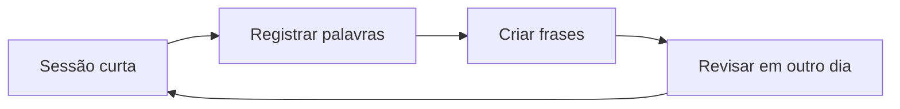

<h1 align="center">Laboratório de Idiomas</h1>

  <strong>Pequenas sessões, revisão constante e vocabulário em contexto.</strong> 
  Registros de estudo para espanhol, chinês e japonês.

   &nbsp;
  🇪🇸 &nbsp; 中文 &nbsp; 日本語

## Idiomas

| Idioma | Porta de entrada | Foco atual |
|---|---|---|
| **Español** | [Abrir notas](spanish/00_lan_spn_10082026.md) | vocabulário e frases básicas |
| **中文 · Chinês** | [Abrir notas](chinese/00_lan_chn_10082026.md) | vocabulário e diálogos |
| **日本語 · Japonês** | [Abrir notas](japanese/01_lan_jpn_25082026.md) | vocabulário e frases |

## Ciclo de revisão

As notas seguem o padrão `NN_lan_<sigla>_DDMMYYYY.md`, com uma pasta dedicada para cada idioma.

Voltar para a [Personal Knowledge Wiki](../README.md).
