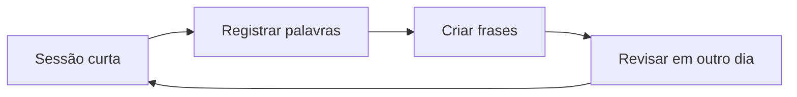

<h1 align="center">Laboratório de Idiomas</h1>

  <strong>Pequenas sessões, revisão constante e vocabulário em contexto.</strong> 
  Registros de estudo para espanhol, inglês, francês, italiano, alemão, chinês e japonês.

   &nbsp;
  🇪🇸 &nbsp; 🇬🇧 &nbsp; 🇫🇷 &nbsp; 🇮🇹 &nbsp; 🇩🇪 &nbsp; 中文 &nbsp; 日本語

## Idiomas

| Idioma | Porta de entrada | Foco atual |
|---|---|---|
| **Español** | [Abrir notas](spanish/00_lan_spn_10082026.md) | Duolingo, níveis 1–41 |
| **English · Inglês** | [Abrir notas](english/00_lan_eng_10112026.md) | Duolingo, níveis 1–45 |
| **中文 · Chinês** | [Abrir notas](chinese/00_lan_chn_10082026.md) | Duolingo, níveis 1–9 (com gramática) |
| **Français · Francês** | [Abrir notas](french/00_lan_fra_10112026.md) | Duolingo, níveis 1–24 |
| **Italiano** | [Abrir notas](italian/00_lan_ita_10112026.md) | Duolingo, níveis 1–21 |
| **Deutsch · Alemão** | [Abrir notas](german/00_lan_deu_10112026.md) | Duolingo, níveis 1–23 |
| **日本語 · Japonês** | [Abrir notas](japanese/00_lan_jpn_10082026.md) | Duolingo, níveis 1–10 (com rōmaji) |

## Ciclo de revisão

As notas seguem o padrão `NN_lan_<sigla>_DDMMYYYY.md`; as páginas de nível do Duolingo usam `NN_lan_<sigla>_duolingo_level_NN_DDMMYYYY.md`, com uma pasta dedicada para cada idioma. Todo exemplo em escrita não latina traz rōmaji ou pinyin.

## Questões de revisão

Cada idioma tem um banco de 200 perguntas de múltipla escolha (50 por dificuldade: `easy`, `medium`, `hard` e `expert`), com perguntas de código, equação e gramática. Os arquivos estão em [`questions/`](../questions/README.md); o chinês tem duas rodadas e o japonês e o chinês trazem rōmaji e pinyin em todo exemplo.

Voltar para a [Personal Knowledge Wiki](../README.md).
